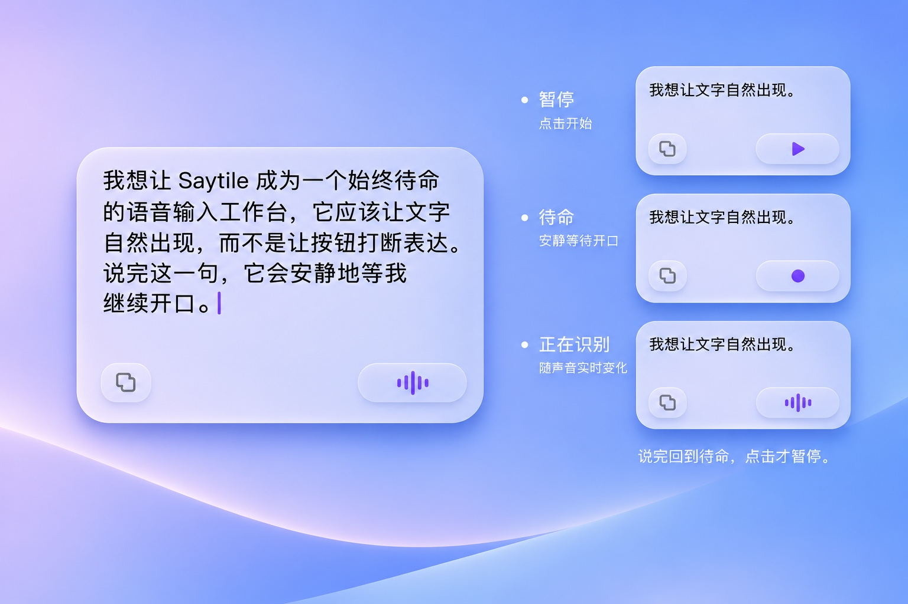

# Saytile｜唯一批准的视觉设计原稿

**唯一视觉基准：** [Saytile-original-visual-reference-20261107.jpeg](Saytile-original-visual-reference-20261107.jpeg)。

这份 1536×1024 JPEG 是用户在 2026-11-07 对话中直接上传并再次明确指定的**完整原图附件**，在仓库中按附件原始字节保存。它不是设计师二次绘制的复刻图、合成原生截图、从原图裁剪的局部图片或另一个品牌方案。没有取得比这份附件更早的无损设计源文件，不能假称它是原始分层 PSD / Figma / PNG。

- 原始文件 SHA-256：`58be88a019cf0241b1c540f799d0944ed294e650b8c119923a434a6e4889a7c5`
- Git blob SHA-1：`5b89c1c6e51dbf842a9bf20aded0155494bbb306`
- 尺寸：1536×1024 像素
- 原图相对尺寸、排版、玻璃层次、按钮形状与色彩优先于现有代码、色彩 token、数值测量、概念描述、任何测试截图以及历史 PR 近似版本。

## 唯一允许偏离原图的范围

用户只批准以下**行为和必要的按钮内部短动效**：日常只有暂停（含未开启，向右三角）、待命（静止紫色圆点）、正在识别（五根圆头小竖条，条高受当次真实麦克风幅度驱动）。用户停止说话后经 VAD 确认应回待命并继续收音，不是自动暂停；只有用户点击才暂停。三角、圆点、小竖条之间可以有自然、可中断的短过渡，不改变胶囊的尺寸或位置。

原图左侧的大玻璃卡片是生产面板，右侧三个小卡片是**同一面板三种状态的示意**，不是同时展示的多个窗口。**面板本身是白色微透玻璃，非蓝紫渐变涂层；蓝紫色来自后方桌面环境透过玻璃的视觉效果。**复制按钮、语音胶囊底色及阴影保持中性，只有语音状态图标与正文光标使用紫色。周围的桌面背景与状态说明文字仅用于展示，不能当成修改用户壁纸、面板内标签或新控件的要求。面板内部始终为上方连续正文、左下灰色复制按钮、右下紫色语音胶囊两个控件。

## 视觉验收纪律

每次更改面板外观，都必须将**生产 App 原生窗口渲染**与**本文件**在同一参考比例下逐项比较：主卡片的比例/曲率、文本字形/字号/行高/换行、四周留白、复制图标、两个底部按钮、颜色、折射/高光、边框和阴影。参考测量数据 [original-reference-20261107.measurements.json](original-reference-20261107.measurements.json) 只服务于图像，不覆盖图像。CI 和合成截图通过不等于已完成一比一视觉复刻，也不等于用户最终批准。

**未经用户明确批准，不得覆盖或静默替换此基准图。** 如果用户以后提供更新原图，需单独提交新文件、更新文件校验值并记录替换原因。
