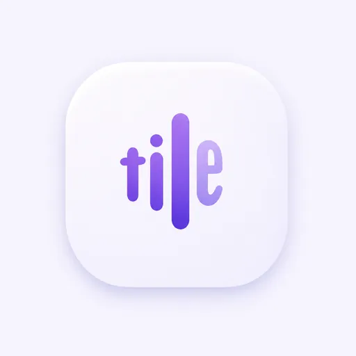

# Saytile｜App 图标唯一视觉权威

> **APPROVED · 2026-11-10 · 产品 App Icon / Logo**
>
> 本目录中的图是用户在多轮设计比较后，**最后明确选定**的白底紫色「tile 声波字标」设计。若历史图标方案或既有生成器与此冲突，以本图和本文件为准；未经用户再次明确批准，不得替换图形、配色、比例或品牌方向。

## 正式视觉参考

- **仓库参考图**：`Saytile-AppIcon-Approved-2026-11-10.webp`，512 × 512 WebP；由批准的 1254 × 1254 PNG 缩放编码，目的是在 GitHub 内直接展示。它是视觉参考图，不应被误认为无损、原分辨率的母版。
- **批准源图名称**：`紫罗兰声波字标应用图标.png`（本次对话中确认的版本），1254 × 1254，RGB PNG。
- **源图 SHA-256**：`23e1a4323dc826b326757dc95b948539b0de4992b28b89f150165d05f2d289dc`。
- **仓库参考图 SHA-256**：`607fe0dca53a186835a35e82b0c9241975e11b9e3481e6dfb11502fe60d5f35c`。

**保真优先级**：批准的原始 PNG（上述哈希） > 本目录的缩小预览 > 根据图片重绘的 SVG / 各尺寸派生文件。重绘不是重新创作许可证；未经逐像素及小尺寸视觉审查，不能擅自宣布派生图等同于母版。

## 固定造型

1. 以 **小写 `tile` 字母骨架融合纵向语音声波**，而不是普通五条均衡器，也不是声波后面附加字母。
2. `t` 为圆润竖笔与短横；`i` 为小圆点和细长竖笔；`l` 是中央最高的连续圆角柱；`e` 是偏窄、圆润、右侧开口的字形，作为最后一个声波节拍融入整体。
3. 原图的柔和紫色到浅薰衣草紫色过渡、宽松留白、圆润端点、白色圆角方形底板和克制阴影均须继承。不得擅自换成深色或紫色实体底板、荧光紫、厚重拟物、额外波纹或字标说明文字。
4. 优先保持图形 **整体美感与声波节奏**，兼顾隐含的 `tile` 可读性；不得通过过度夸张的 t 横笔、独立的 e 或繁复切口牺牲整体。

## 范围、冲突及工程状态

- **本图权威适用于**：Saytile App Icon、Finder / Dock / 安装包 / 官网与品牌展示中的正式产品图标，以及由其严格派生的品牌小图形。
- **不修改主界面**：Saytile V1 输入板仍依照 [唯一界面设计规范](../../../docs/SAYTILE-V1-COMPACT-TRANSCRIPT-PANEL-DESIGN.md)，顶部无 Logo / 产品名，连续文字流为主体；白紫 App Icon 不等于要求把它放在输入板内。
- **废止范围**：既有绿色三竖条生成器（`scripts/make-icon.swift`）及其他历史 Logo / App Icon 方向不再具有**设计权威**。可保留供现有构建和溯源，不能据此推断旧图标已被认可。
- 签名体验包的 Finder、菜单栏和悬浮入口使用此参考生成的图像。可用 `scripts/extract-brand-assets.py` 重建原生派生资源。
