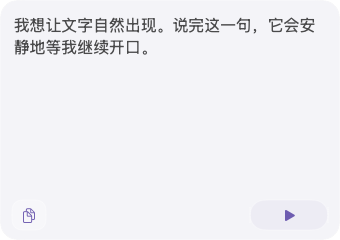
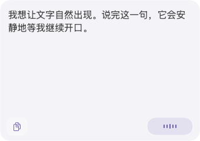
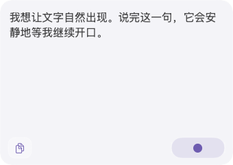

# PR #6｜紧凑语音面板中断任务续接

## 本轮范围与基线

2026-11-07按用户附件 `IMG_4388.jpeg` 继续中断任务。仓库为 `haohongfei2001-png/saytile`，继续原PR #6及分支 `engine/single-transcript-integrated-20261107`；恢复时远端head为 `4df87ad4dd7ff94da2027f0c978ca5c5cb1d7292`，tree为 `ce2a3fed6a27a96ed4dca80abeac307793d4e705`。

本轮目标是把界面规范与原生面板统一到最新截图，不重做识别架构或扩大V1范围。截图SHA-256为 `98e2e63b1c06c46d02ff049687f24f00653fa6fdba7c52b77fe8794a0886e11d`；它是聊天截图，不是原始设计PNG，未将聊天截图上传仓库。

提交实现前发现远端并发提交 `28ef90fce8640589ee7f192e54407d957da31b54` 新增旧顶部布局no-api.5安装包与验证证据。已检查其175个变更文件，没有改动本次运行代码与回归文件；本次基于该提交追加修改，完整保留其交付物、文档和哈希条目。

## 已固定的最新规则

- 主面板不设顶部操作栏；底部仅左复制与右侧语音胶囊两个常驻按钮。
- 日常状态只有暂停、待命、正在识别；首次未开启归入暂停，外观为播放三角。
- 待命使用静态圆点；只有当前真实讲话触发随声音变化的波形。
- VAD确认讲话结束就回待命，采集保持开启；后台ASR/GPT定稿继续更新同一份文字。
- 上一段迟到结果不重置新讲话、不重启主动暂停的采集；编辑与其他能力保留在菜单或已有入口。
- 启动可取消，异常如实反馈；不把异常和技术过渡作为第四个日常语音状态。

唯一规范、AGENTS、README、当前交付入口及批准资产说明已同步。旧PR评论里的顶部/四状态/等待定稿描述已被本次规则覆盖；历史证据保留原状。

## 源码核对发现

恢复基线的 `InputPanelView` 仍把语音控制和更多菜单放在顶部，底部另有复制和编辑；不符合最新截图。

`PanelCapturePresentation` 把 `currentRecognitionActive` 与 `.speaking` 合并，导致声音结束后只要后台识别仍活跃就继续呈现识别态。音频核心已经独立运行VAD与后台识别，本轮应修正呈现映射并保留原有保存/定稿流程。

## 验证状态

规范已在提交 `3da2c3f122ea09e10f4d6d14c3f736303633b83e` 持久化。原生实现与回归提交为 **`9d2d2346b867de67f59d874a656ee56af7e29f95`**，其macOS与设计契约CI均通过。CI实际检出合并提交 `da1a3bb7730647a4e234440cf24a9a088b791778`，已核实与该实现提交拥有完全相同的tree `8b566394102b779e16b17a4965ea001ecc5346fc`；App报告源码无未提交修改。

### 原生实现与回归变更

- `Views.swift` 移除顶部操作行，底部为34×30复制按钮和78×30语音胶囊。编辑、回到最新、模式与导航均通过复制按钮的上下文菜单保留；空文本时复制为无操作，菜单宿主仍可用。必要错误信息与目标提示保留，不新增关闭提示按钮。
- `AppModel.swift` 删除独立未开启态；首次和暂停均为播放三角，仍区分无障碍的开始/继续动作。主按钮只从当前采集状态派生，不再依赖ASR/GPT活跃度；启动取消和故障恢复保留。
- AppModel生产模型回归覆盖声音结束、queued/running/fusion期间待命、旧任务完成/失败不能重置新讲话，以及用户文字与后台任务保持独立。
- 原生AX探针枚举全部可按控件，避免漏掉没有identifier的第三按钮；要求两个按钮在窗口底部。菜单使用AXShowMenu，从实际复制控件进入，编辑/回到最新仍通过原生菜单操作验证。
- 默认无AX权限的CI路径新增五张生产SwiftUI合成场景截图，覆盖待命、讲话、后台仍在修正时的待命、完成后仍待命及暂停；不把注入状态与程序化模型动作冒充真实按键或麦克风。
- CI保留原生截图、运行日志和manifest，便于复核新布局与对应源码。

### 实际执行结果

| 验证层 | 本轮结果 |
|---|---|
| macOS原生CI | [42328995554](https://github.com/haohongfei2001-png/saytile/actions/runs/42328995554)通过；391项Swift测试、47个套件 |
| 生产AppModel | 101项检查通过，包含本轮静音/待命及旧结果与新讲话的竞态回归 |
| 原生渲染 | 27张生产SwiftUI/AppKit截图通过；真实原生文本选区、Unicode、手动滚动与near-bottom检查保留并通过 |
| 设计与数据契约 | [42328995530](https://github.com/haohongfei2001-png/saytile/actions/runs/42328995530)通过 |
| 构建与启动 | 原生App构建、隔离CLI边界及无麦克风启动通过；候选App保存在同次CI artifact |
| 截图检查 | 已逐张打开暂停、讲话、后台仍在修正时的待命与内容面板PNG，确认无顶部操作行、底部两按钮及三种图形；后台修正与完成后的待命图片哈希相同 |
| 原生AX菜单/点击 | 本次CI为render-only，未执行；不能把探针源码更新或合成模型动作写成AX实际点击通过 |

本地精确diff、Python语法及独立代码审阅通过。已验证截图ZIP哈希以及manifest中全部27张PNG哈希；四张相关原生图片、原始manifest/UI日志、CI摘要和源码身份已保存在[本轮证据目录](../evidence/approved-ui/bottom-controls-20261107/README.md)。

| 暂停：播放三角 | 讲话：真实幅度波形 | 声音结束、后台修正中：待命圆点 |
|---|---|---|
|  |  |  |

本轮原生验证使用macos-26 CI。声音边界为明确注入的合成状态，没有采集真实麦克风；视觉核对针对布局、控件和状态图形，不是原始PNG的像素级复刻或用户最终视觉验收。没有将CI渲染、旧版测试或合成动作冒充真实设备/AX交互通过。

旧no-api.4/no-api.5工程记录仍是各自源码版本的证据。真实麦克风、真实云识别质量、安装与长期运行不在本次面板修订的已测范围内。
