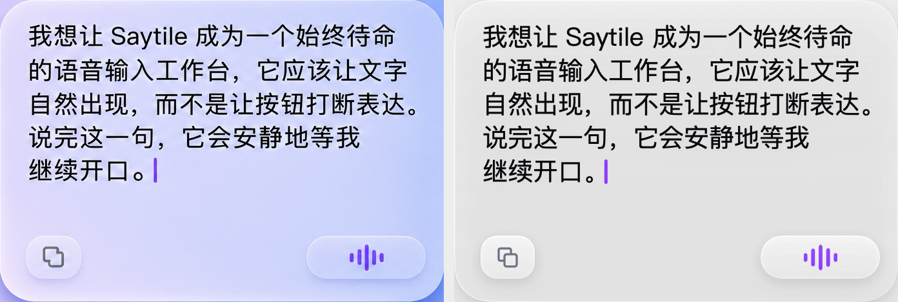

# Saytile 连续语音时间轴 · 原生预览

[Draft PR #12](https://github.com/haohongfei2001-png/saytile/pull/12) 从 [PR #11](https://github.com/haohongfei2001-png/saytile/pull/11) 的设计分支建立。安装包的实际源码为 86dbd24dd3e33d3a945301007ddd8dbfa3d0a97c，版本为 1.0.0-timeline.preview.1。预览采用独立应用名、Bundle ID、偏好、默认档案目录和 Keychain 服务。

[签名 DMG](../deliverables/timeline-preview/Saytile-Timeline-Preview-arm64.dmg) · [SHA-256](../deliverables/timeline-preview/SHA256SUMS.txt) · [安装、授权与回退](V1-TIMELINE-PREVIEW-INSTALL.md) · [机器收据](../evidence/timeline-preview/machine.json)

## 使用与数据契约

- 开口后每段按实际采集顺序追加。分组起点由 VAD 检出的语音采样位置映射到本机时间，终点扣除尾部静音。空闲达到阈值、跨本地日期或系统时钟倒拨，会建立新组。默认试验值为 120 秒，用户可在设置中更改；已形成的组保持原边界。
- 空闲时旧文字沿原生文字流上移，向上滚动即可回看。历史时标使用组内第一次讲话的日期、当地时间和已保存的 UTC 偏移。按住选区或阅读时保留锚点，正在编辑的草稿保持原文字。新讲话与后台修订依据录音 ID 寻址。
- 底部左键复制实际选区；无选区时即时复制最新活动组，包括该组已翻出当前页的内容。复制不等待定稿。剪贴板只在点击时写入一次。最新活动组作为默认复制范围已经过交互验证，仍是待体验确认的产品细节。
- SQLite v6 在一个事务中创建和回填时间轴。每页最多 64 段，相邻页面重叠。原音、文字、用户版本及派发账本保留旧 ID 和所有权。升级前资料没有采集时区时，日期按迁移时区还原；旧段结束时间按可用的原音时长估算。
- 真实识别仍使用每段一个 ASR 和一个 GPT-6。设置允许手动指定候选 ASR，改变路由对下一段生效。文本复核保留口语、重复和否定词，缺少证据时保留原话。模型最优排名需要另行取得真实质量数据。说话人身份识别留待后续立项。

## 机器验收

| 状态 | 场景 | 观测 |
|---|---|---|
| PASS | 原生回归 | 本机 Apple Silicon macOS 27.0 及 Swift 6.4，全套 405 项 Swift Testing，0 失败；AppModel 104 项检查通过。localhost 52 个协议场景无协议违例。 |
| PASS | 多段、超时前后接续、迟到修订 | 真实 App 连接隔离 SQLite。多个短停顿属于同组，达到阈值后提示空间空出，下一次讲话另起组。迟到文本留在原位置，未保存的编辑稿及已复制内容保持原值。实机动画使用设置中支持的 10 秒档，120 秒默认值另有边界断言。 |
| PASS | 跨午夜、时钟变化与重启 | 跨午夜出现日期分界；时钟倒拨另起组。用洛杉矶春季跳时及秋季回拨时刻写入，在上海时区重开，日期、UTC 偏移、组 ID 保持一致。 |
| PASS | 历史滚动、选区、恢复到最新 | 真实 NSScrollView / NSTextView 接收滚轮、Unicode 选区及 Store 更新；面板收起再打开可回到最新。AppKit 原生菜单进入已有档案编辑器，暂停与恢复控制通过隔离采集边界验证。 |
| PASS | 一键复制 | 同组两段只复制活动组。选中旧段时真实 AXPress 只复制选区。迟到修订后私有剪贴板 changeCount 和原文字不变。原有收音状态、焦点及选区保持。 |
| PASS | 长期档案 | SQLite v5 的 12,001 段合成记录迁移后用 188 次分页完整遍历，本机该次合计约 0.357 秒。签名 App 在 12,003 段时实测一次跨页滚轮至绘制约 24 毫秒，原生视图保留 64 段。此数值是单次观测。 |
| PASS | 真实外部输入隔离 | 本机对独立 NSTextView 和 WKWebView 执行 AX 操作。回看、再次投递旧范围及目标变更均未重放历史。旧段的插入资格由独立派发账本决定；目标没有自动发送。独占托管机另用生产前台解析器验证。 |
| PASS | 原音与升级回退 | 40 秒真实时间合成 PCM 经生产采集、VAD 和 SQLite 生成 2 段，丢帧 0。冻结 RC2 从只读镜像启动并建立 v5 合成档案；签名预览从新 DMG 复制、启动、升级、再启动，原音散列、两个版本、首选稿和未提交草稿一致。从完整 v5 备份回退通过。 |
| PASS | 视觉与控件 | 签名 App 原生窗口实测内容卡片 344 × 234 pt，字号 19.5 pt。原图与同内容原生画面均为五行；11 次控件检查确认底部恰好两个动作。29 个带原始时间戳的窗口帧记录了真实上移。 |
| BLOCKED | 源码提交的托管 Xcode 复测 | GitHub 在排队 15 分钟后取消任务，未分配执行机，运行步骤数为 0。同一源码的托管前台输入任务通过；本机 405 项通过。包含交付证据的提交由 PR 检查另行记录。[调度收据](../evidence/timeline-preview/attempts/source-hosted-capacity.log) |
| FAIL | 下载分发 Gatekeeper | 安装包和 App 的 Developer ID 签名通过，Hardened Runtime、可信时间戳有效。系统评估返回 Unnotarized Developer ID。 |
| BLOCKED | 公证分发 | 本次提供签名工程预览。正式公开安装仍需 Apple 公证与装订。 |
| NOT_RUN | 云端与真人 | 未调用收费服务、采集私人录音或上传样本。真人识别准确率、最优 ASR 和最终主观视觉评价留待独立验收。 |

[Swift 原始结果](../evidence/timeline-preview/tests/swift.log) · [原生交互](../evidence/timeline-preview/timeline/run.log) · [复制与录屏收据](../evidence/timeline-preview/timeline/receipt.json) · [日历时区](../evidence/timeline-preview/calendar.json) · [独立安装](../evidence/timeline-preview/install.json) · [托管 Xcode 和前台输入](https://github.com/haohongfei2001-png/saytile/actions/runs/42657428417)

### 视觉对照

左侧为批准的 JPEG 原图主卡片，右侧为同尺寸、同内容、同字号的签名预览窗口。原图含紫蓝壁纸，右侧截图只捕获测试窗口本身，两侧底色不同。合成语音状态用于验证动态图形及控件，不代表真实讲话质量。[几何与逐区测量](../evidence/timeline-preview/reference.json)

[讲话追加](../evidence/timeline-preview/timeline/timeline-live.png) · [跨午夜回看](../evidence/timeline-preview/timeline/timeline-midnight.png) · [选区保护](../evidence/timeline-preview/controls/panel-selection-held.png) · [空闲后留白](../evidence/timeline-preview/timeline/timeline-idle.png) · [实际原生窗口录制](../evidence/timeline-preview/timeline/idle-transition.mov)

### 已复现问题与整合顺序

开发阶段修复了物理删除被新增外键阻断、活动组上方露出上一行残笔、延迟的原生滚轮通知和保留空白高度之间的竞争，以及空段首个识别回调抢先进入复制快照。Xcode 26.6 的设置绑定编译器崩溃已修复。签名包控件探针对同一节点逐个读取属性曾出现 0 个节点，现用一次 AX 请求读取结构并要求完整控件清点。早期独占 WKWebView 曾在首次派发前拒绝绑定，亦曾写入一次但未获得确认；这些失败收据保留，遇到不确定投递仍拒绝重放。[历史实测](../evidence/timeline-preview/attempts)

本 PR 保持 Draft。先在设计分支审查真实交互和复制范围，随后在独立整合候选中恢复正式应用身份、用完整副本演练 v5 → v6，再进入云端授权和发布公证。主分支、RC1 和冻结 no-api.10 安装包维持原指针；无需用户现在录音或调试。
