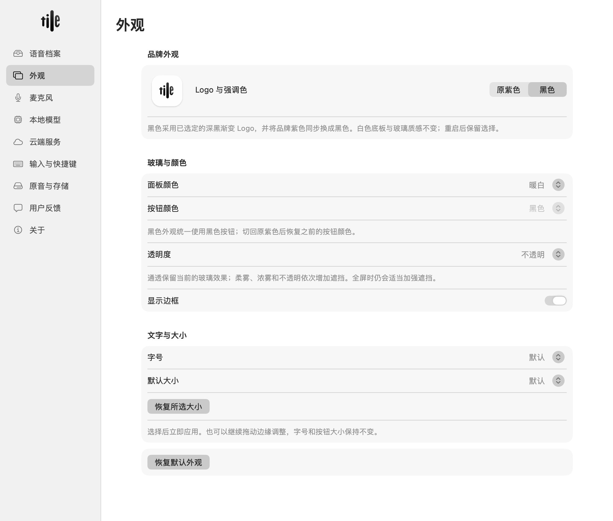

# 0.21（557）机器验收

日期：2026-11-23（Asia/Shanghai）。安装包和原生测试绑定产品源码 `9aace8f5b0d7082bd67d2e9b1b6e1db6dcf05883`，主程序 SHA `10895f5a01c615d408ac7fb95b9aac98ff2982638979bd11590d135e94fb6d33`。后续 fixture 修复在 `94db534265597e4bc26109e2d849b2406f62edb3`，产品代码、资源、运行时和打包脚本没有变化。

## 本机签名候选

| 项目 | 状态与证据 |
| --- | --- |
| 原生档案、选区、编辑、复制、回听、星标 | PASS。56 次 AXPress、7 次真实边缘点击；43 张常规和 3 张参考尺寸图，使用隔离合成资料。见 [manifest](../../../evidence/beta-021/final/native-ui/manifest.json)。 |
| 外观与品牌 | PASS。11 次真实菜单选择，边框/尺寸/还原与黑色/原紫色 AXPress 往返；文字、选区、编辑器和自定义偏好保持。共20张图，见 [receipt](../../../evidence/beta-021/final/appearance/receipt.json)。 |
| 实际材质与窗口 | PASS 工程场景，22 个 WindowServer 合成截图，捕获仅限同一隔离进程的两扇自有窗口。权限状态和讲话状态注入，不是物理授权/真实麦克风。[receipt](../../../evidence/beta-021/final/composited/receipt.json)。 |
| 数据异常与旧版迁移 | PASS，18项。真实 SIGKILL、PCM 首写和轮转、WAL/事务、删除意图、低存储写失败、Beta/RC1→v6、幂等恢复。断网由进程禁止网络覆盖；实体突然断电 NOT_RUN。[receipt](../../../evidence/beta-021/final/storage/receipt.json)。 |
| 533↔557 升级回退 | PASS，四步往返，九张表、2份WAV、4个版本和2份编辑稿哈希保持；模型标记不重下。Keychain 服务名与签名要求检查，未读真实密钥。[receipt](../../../evidence/beta-021/final/rollback.json)。 |
| 原生 Sparkle | PASS，损坏包拒绝、有效包安装、无参数重启、数据及模型标记保持。loopback 和临时密钥，真实安装器配隔离用户驱动，不是公共线上更新或人工标准弹窗点击。[receipt](../../../evidence/beta-021/final/update/receipt.json)。 |
| 最终中文管线 | 正常原速、压力和440段质量分别报告，不合并成“全部PASS”。[质量](QUALITY.md)。 |
| 15分钟以上原速长测 | PASS：905.02秒真实原速，47/47完成、79块WAV逐块字节匹配，SQLite完整、0外部派发；45秒静音期间释放helper，随后恢复。[收据](../../../evidence/beta-021/final/soak.json)。 |
| Developer ID / Gatekeeper | 签名及时间戳 PASS；Gatekeeper 实测拒绝未公证包，公证 BLOCKED。 |

实际检查了黑色设置、黑色主板、紫色档案与同尺度原图对照，没有重新设计主板。紫色保持默认；黑色仅改变可选品牌和强调色，不能篡改已签名 Finder 图标。运行中的 Dock/菜单/设置图形切换不代表静态安装图标更换。当前固定字号和按钮仍小于早期概念原图，可选边框也不相同；继承 PR49 后续产品决定，不能称为像素一致或用户已批准所有细节。

## Xcode 与真实前台输入

[GitHub native run 45083846290](https://github.com/haohongfei2001-png/saytile/actions/runs/45083846290) 使用完整 Xcode，测试源为 `94db534`。Swift Testing 567/567（38项协议分组加529项其余完整套件），XCTest 30/30，失败0；没有把断言改为跳过。AppModel 220项及原生窗口、反馈离线重启、12000条时间轴作业均成功。四个workflow共六项作业全部success，[完整CI收据](../../../evidence/beta-021/final/ci-94db534.json)；完整native日志保留。

真实前台作业 PASS：WKWebView/AppKit 首次和追加、重复抑制、局部范围修订、手改/光标/目标变化、取消、未知结果禁止重发；TextEdit及独立Chrome的实际Unicode插入、前后文保持、追加和中断确认；零回车、零发送。所有目标是一次性隔离窗口，没有读取或写入用户聊天。完整 [前台日志](../../../evidence/beta-021/final/ci-94db534-foreground.log.gz) 和 [各目标机器证据](../../../evidence/beta-021/final/foreground-94db534.zip) 保留。

原始失败在 `9aace8f`：网页上下文一次读不完整，但焦点、窗口、编辑框、光标等均相同；fixture把“不完整”当作“改变”。只允许同URL/标题、所有独立属性不变的缺失观察重置就绪计数；仍须在原五秒期限内得到三次完整一致观察。17项属性变异回归，产品拒绝不确定写入的行为不变。没有写入重试、重新绑定或重新抢焦点。[原始失败与修复](../../../evidence/beta-021/final/foreground-readiness.md)

## 未被证明的范围

- BLOCKED：真实 iCloud Mac上传/新Mac恢复/iPhone回听，当前0条/0字节；反馈私有工单送达；新包公证。
- BLOCKED：托管Mac不支持实际硬件睡眠（VirtualMac2,1，sleep request 71）。旧版全屏退出后系统保留被排斥窗口原几何的特定路径仍无法在虚拟机触发。没有把这些记PASS。
- NOT_RUN：合盖内置麦克风、用户个人口音、8GB机器、功耗/GPU/ANE、真实突然断电和显示器热插拔。
- iPhone Simulator的2项 UI 和离线恢复为PR49既有证据，本轮未改变读端，也未把它们冒称最终557的真实CloudKit验收。

长测5秒采样：App CPU中位5.2%、RSS峰122.91MiB；ASR helper CPU中位22.6%、RSS峰799.0MiB。首/末5分钟RSS中位分别App117.02/114.02MiB、helper793.61/794.78MiB。这是进程采样，不是整机功耗或物理内存压力证明。

最终证据提交 `d03f446` 又复现一次前台失败：同目标的完整文字见证暂不可读，被fixture当作变化；发生于首次写入前，绑定仍有效、观察通知为0。原始日志/ZIP已保留。后续仅修fixture，缺失证据重置原期限内的就绪计数，已读出不同文字仍立即拒绝。22项编译回归通过；真实AppKit/WKWebView加入一次缺失就绪见证的明确注入，正式产品读取及安全条件不变。最终fixture CI以PR #51最新head为准，不能沿用94db534成功覆盖新失败。
