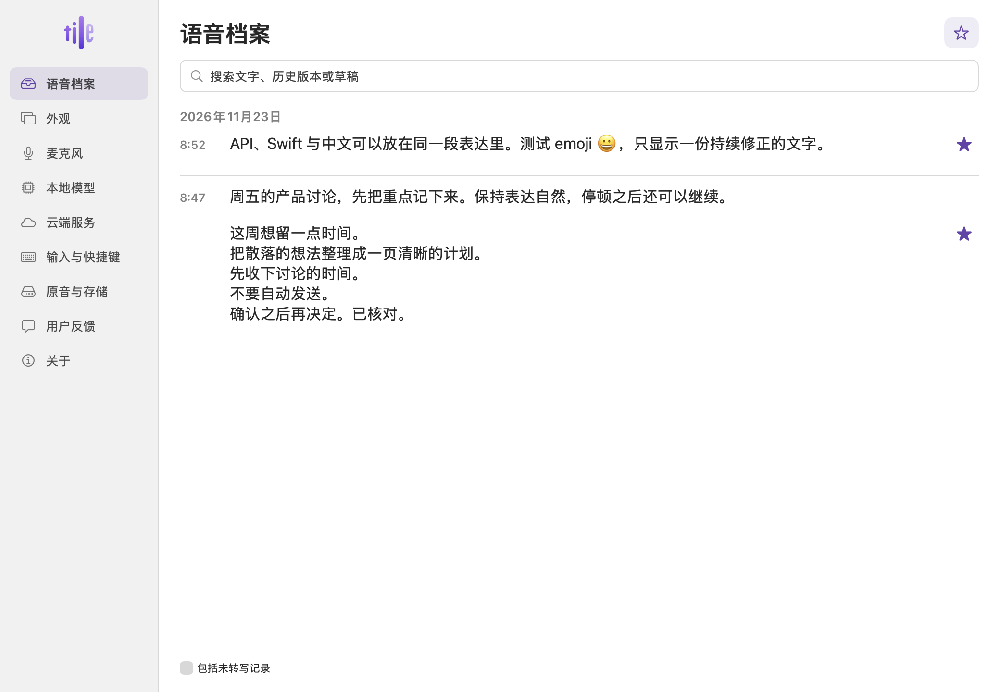
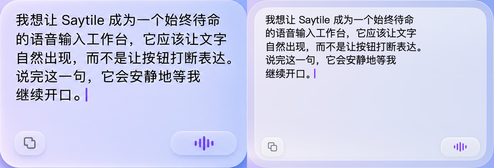

# 0.21（563）机器验收

日期：2026-11-23（Asia/Shanghai）。最终安装包源码 **`8514fea5d45a778aae84854db9b139f7a1fbb85b`**，主程序SHA `6bdc43a58c22af783a061ed875b7f2b1f11c747574929cd2a8cb6cd1c890a8eb`。逐项来源见 [最终机器收据](../../../evidence/beta-021/final-563/machine.json)。

## 最终本机签名包

| 项目 | 状态与证据 |
| --- | --- |
| 原生档案、选区、编辑、复制、回听、星标 | PASS：56次AXPress、7次边缘点击、9次菜单选择，43张常规及3张参考尺寸截图；隔离合成资料。[manifest](../../../evidence/beta-021/final-563/native-ui/manifest.json)。 |
| 最终三段原速语音 | PASS：相同15段集中的三段，真实模型→正式音频管线→AppKit→SQLite；结束前18/9/17个不同文字状态，最终稿与完整回归一致。不是新增全量质量测量，也不是现场麦克风。[receipt](../../../evidence/beta-021/final-563/smoke3/receipt.json)。 |
| 数据异常与旧版迁移 | PASS，18项：真实SIGKILL、PCM首写和轮转、WAL/事务、删除意图、存储不足写失败、Beta/RC1→v6、幂等恢复。进程禁止网络；物理断电NOT_RUN。[receipt](../../../evidence/beta-021/final-563/storage/receipt.json)。 |
| 533↔563升级回退 | PASS，四步往返，9张表、2份WAV、4个版本和2份编辑稿哈希保持，模型标记不重下。只检查Keychain服务名和签名要求，未读真实密钥。[receipt](../../../evidence/beta-021/final-563/rollback.json)。 |
| 原生Sparkle | PASS：损坏包拒绝，有效包安装、无参数重启及资料保留。真实安装器配临时loopback源/密钥和隔离用户驱动；不是公共更新源或普通弹窗人工点击。[receipt](../../../evidence/beta-021/final-563/update/receipt.json)。 |
| 签名、公证、Gatekeeper | Developer ID、安全时间戳、严格签名PASS；Gatekeeper实测拒绝未公证包，公证BLOCKED。[receipt](../../../evidence/beta-021/final-563/signature.json)。 |

上述本机UI仅操作自有临时PID和隔离数据；窗口不可成为key/main，控制、截图、编辑前后均检查，outside_foreground_observations=0。状态/授权UI场景由fixture注入，不冒称真实系统权限或物理麦克风通过。

## 完整Xcode和真实前台输入

产品源码 `8514fea` 的 [native run 45090352675](https://github.com/haohongfei2001-png/saytile/actions/runs/45090352675) **SUCCESS**。完整Xcode运行567/567 Swift Testing、30/30 XCTest，失败0；时间敏感的38项分组和其余529项分进程执行，所有测试均执行，未将失败断言改为跳过。AppModel 220项、实际原生窗口、反馈离线重启、12000条时间轴等步骤成功。四个workflow共 **7项作业全部success**（native3、design1、cloud2、brand1）。[精确CI收据](../../../evidence/beta-021/final-563/ci.json) · [完整native日志](../../../evidence/beta-021/final-563/ci-native.log.gz) · [Swift日志](../../../evidence/beta-021/final-563/ci-swift.log.gz)。

真实前台 **PASS**：WKWebView/AppKit首次和追加、重复抑制、长短范围修订、用户编辑/光标/目标变化、取消、未知结果禁止重发；TextEdit及独立Chrome实际Unicode插入、前后文保护、追加、切换目标及首次确认中断。零回车、零发送。全部使用托管Mac的一次性隔离窗口，不读取用户真实聊天。[完整前台日志](../../../evidence/beta-021/final-563/ci-foreground.log.gz) · [原始目标收据ZIP](../../../evidence/beta-021/final-563/foreground-8514fea.zip)。

已复现并分别处理：fixture将暂不可读的page/witness误判为已变化；生产AX串行上下文读取开销；新字段批读对AppKit的兼容回归。最终仅批读同组上下文/祖先属性，字段保持既有读取方式。缺失证明仍拒绝写入，完整上下文150ms预算和消息120ms超时不变，无缓存身份、盲重试、自动重取焦点或放宽所有权。[全部原始失败及修复过程](../../../evidence/beta-021/final/foreground-readiness.md)。一次通过不保证任何浏览器永远可读；不确定投递仍不重播。

## 保留实际来源的长测与视觉证据

以下实际来自557产品源码 `9aace8f`；最终563仅改InputAccessibility，ASR/音频/存储/UI及模型运行库载荷相同，[组件对照](../../../evidence/beta-021/final-563/component-equivalence.json)。未把这些旧收据改写成563实测。

- 外观：11次真实菜单选择，边框/字号/尺寸/还原及黑↔紫AXPress往返，保留文字、选区和独立偏好，20张图。[收据](../../../evidence/beta-021/final/appearance/receipt.json)。
- 材质：22个真实WindowServer场景，只截取同一临时进程的自有窗口；权限/讲话状态注入。[收据](../../../evidence/beta-021/final/composited/receipt.json)。
- 905.02秒原速长测：47/47档案、79块WAV逐块匹配，SQLite完整，0外部派发；45秒静音期间释放helper后恢复。[收据](../../../evidence/beta-021/final/soak.json)。5秒采样App/helper CPU中位5.2%/22.6%，RSS峰122.91/799.0MiB；首末5分钟RSS中位App117.02/114.02、helper793.61/794.78MiB。不是整机功耗或8GB内存压力证明。
- 常规、压力、440段准确率和561的15段刷新分别保留实际SHA、原始输出和失败；[质量报告](QUALITY.md)，不合并为“全部PASS”。

实际看过黑色设置/主板、紫色档案及同尺度原图。紫色仍默认，黑色是可选强调色；运行中图形可切换，不能修改已签名Finder静态图标。固定字号/按钮和边框继承PR49的后续产品决定，与早期概念原图并非像素一致，主观最终认可不由几何或截图数替代。

## FAIL、BLOCKED与NOT_RUN

- **FAIL**：竞争负载有效新字最长2.564秒；未证明总CPU降低。五个既有子段原模型空final可复现，原音/失败保留。
- **BLOCKED**：新包公证/Gatekeeper放行；真实iCloud Mac上传→新Mac恢复→iPhone回听（0条/0字节）；真实反馈私有工单送达。
- **BLOCKED**：托管Mac不支持内核睡眠（VirtualMac2,1，sleep request 71）；该步骤的成功退出只是记录阻断，非睡眠通过。既有特定“退出全屏后仍保留被排斥窗口租约”路径无法在虚拟机触发。
- **NOT_RUN**：合盖内置麦克风、个人口音、8GB Mac、整机功耗/GPU/ANE、物理突然断电、实体显示器热插拔、普通Sparkle弹窗人工点击。
- iPhone Simulator两项UI及离线恢复为PR49已有证据；读端未改，不能冒称本轮563真实CloudKit验收。
