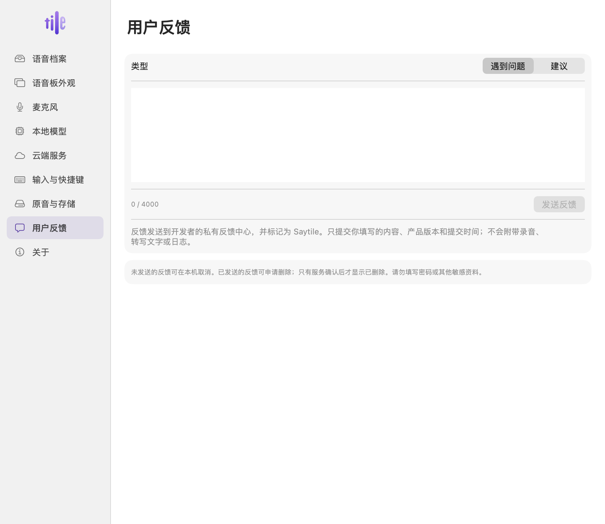
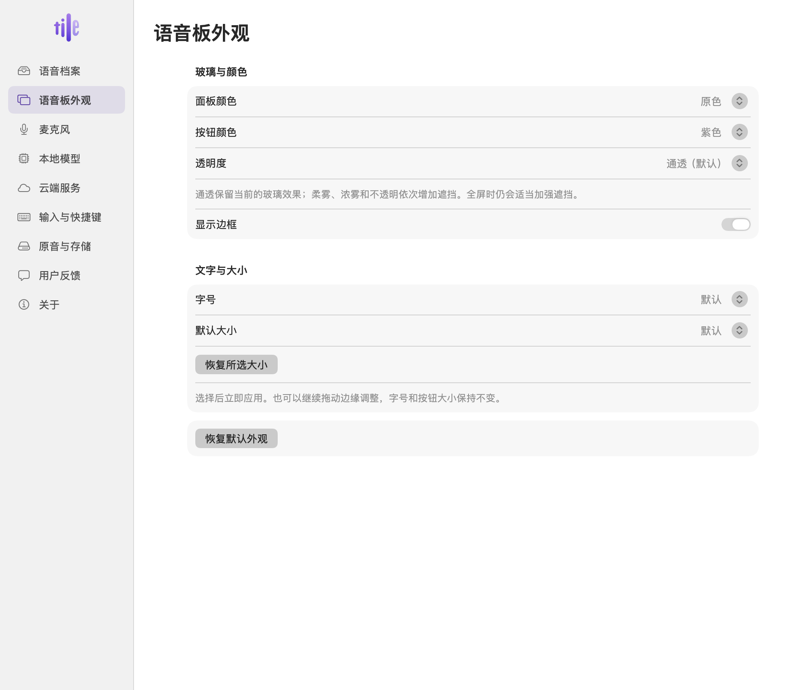

# Saytile 0.19 · 外观预设与用户反馈

产品源码：`412d008be30471abf7cf89e99ee7d4c10ae6cb92`，构建 `500`。本目录是该源码的证据，不是另一个产品版本。客户端 [Draft PR #47](https://github.com/haohongfei2001-png/saytile/pull/47) 叠加在外观预设 PR #46；共享反馈服务是 [Riftlet Draft PR #104](https://github.com/haohongfei2001-png/Riftlet/pull/104)，源码 `6fba674ab4db536efea2090c4e482db73a3b949e`。

## 实现

在现有「语音档案与设置」增加「用户反馈」。用户填写问题或建议后主动发送；草稿和发件箱独立保存在本机，断网后保留同一记录与内容重试，区分收到、送达及撤回确认。退出等待本机写入，不等待网络；未发送的草稿和已有反馈可跨进程恢复。

复用 Riftlet 的反馈核心与既有私有 `haohongfei2001-png/Riftlet-Feedback` 仓库，通过固定 `product:saytile` 分类。Riftlet 的旧格式保持兼容；`product:nearpane` 已预留，未修改 Nearpane 客户端或重新解释其历史反馈。只上传用户主动填写内容、产品、版本和提交时间，不附带录音、转写、诊断或日志。资料目录与 Keychain 命名空间独立。

同一 0.19 保留本轮外观预设：面板/按钮颜色、边框、字号、默认大小以及通透（当前默认）、柔雾、浓雾、不透明固定档位，没有透明度滑条。主板布局、两按钮及原 ASR 运行库保持。

## 验收

| 检查 | 结果 | 范围 |
|---|---|---|
| 最终客户端 CI | PASS 5/5 | 最终源码412d008b，完整原生、foreground、gateway、native-gateway及design contracts全部成功 |
| 共享服务 CI | PASS 5/5 | PR104 最终源码，未部署 |
| Swift Testing / XCTest | PASS 548/548、30/30 | 5组Swift Testing分别为4、13、12、8、511，无测试失败 |
| AppModel / 反馈controller | PASS 188/188、12/12 | 最终源码完整CI |
| 本机签名反馈原生交互 | PASS 13/13 | 真实 NSTextView、AXPress、两次正常进程重启，另两次正/反故障进程 |
| 本机签名外观交互 | PASS 8/8 | 11次原生菜单选择、16张截图，文字、选区及按钮几何保护 |
| 合成资料升级与回退 | PASS | 0.18→0.19→0.18→0.19，2条录音、4个版本、草稿/星标/段界及原音哈希不变 |
| App 与 DMG 签名/校验 | PASS | Developer ID、hardened runtime、timestamp、镜像读回 |
| Gatekeeper / 公证发行 | BLOCKED | Unnotarized Developer ID；没有提交公证或绕过系统安全 |
| 真实 Saytile 反馈送达私库 | NOT_RUN | 新产品路由尚未部署 |
| 用户当前安装及资料 | 保持 | 0.18(492)与受保护App的元数据/执行文件哈希一致；未读取私人档案/设置/Keychain |
| 麦克风与 ASR 重评 | NOT_RUN | 本轮不修改识别，保持合盖且不测私人录音 |

继承的CI条件场景仍如实为NOT_RUN：真实第二显示器拖动、未开启专用GUI标志的原生全屏。通用窗口步骤只做渲染，反馈步骤独立执行13项真实AX检查。5项CI通过不代表这些硬件条件已满足，也不将其改变为跳过失败断言。

本机为 arm64、macOS 27.0 (26A428)、CLT Swift 6.4；完整 Swift Testing 由具有 Xcode 的 CI 执行。原生截图来自真实视图与窗口的 AppKit capture，使用合成文字和注入传输；不是云端送达证据，也不是全桌面背景模糊的像素验收。

## 本轮根因与修复

498 的 CI 在确认撤回后收到 AX `-25205`，旧工具在读取实际结果前退出；原始日志不足以断定那次动作是否完成。独立原生探针随后实际证明：SwiftUI 确认动作可执行一次并关闭确认框，同时 AX 返回该错误。现在该响应只标为 UNKNOWN，不重复点击，必须证明同一记录已删除、恰好一次 DELETE、完整所属窗口树中确认框消失。

499 本机又检出系统确认框使测试进程变为前台；保护断言拒绝继续。SwiftUI 使用独立 `_NSAlertPanel`，父窗口不可聚焦并不足以禁止其应用激活。反馈测试宿主改为 `.prohibited`，校验真实策略；正常产品行为不变。500 的正常路径、真实动作后丢失回复的阳性、完全没有动作的阴性均通过，后者保持 delivered、DELETE=0，绝不误报成功。

另外保留前一轮 Release 编译器循环引用修复：由 actor 独占资源对象关闭 SQLite 与进程锁，避免 imported isolated deinit 的优化器循环，未关闭优化或降低隔离。见项目 `docs/FEEDBACK-RELEASE-COMPILER-REGRESSION.md`。

## 包与运行边界

DMG：`Saytile-0.19-mandarin-arm64.dmg`，65,307,201 bytes。

SHA-256：`9e22efdff60fe4842f507885d003a647edfb1e866a4cec45d02f5584d8a90353`。

可执行文件 SHA-256：`59692c471cda6783349091ddc4ab2971878b0566eb28d514c32a92d837bbeffa`。

签名：Developer ID Application: hongfei hao (ZB9D4T66QB)。模型权重不随包分发；既有 ASR helper、框架与 Metal 库按字节复用，见 `runtime484.json`。完整 DMG、23张正常原生截图、故障截图和构建日志位于本机 `dist/appearance-feedback-0.19-500/`；本目录保留精选截图和所有检查收据。

未安装此包、未修改现有安装、未合并 main、未更新公开下载或更新 feed、未公证、未发布。保留 0.18 签名镜像用于安全回退。实际接通并完成验证后，只沿用既有安装入口更新，不增加另一套长期体验版。

## 唯一外部接通条件

2026-11-16 02:59:14 UTC 再次核验：Wrangler 未认证，可用账户数0。需要账户持有人完成一次已有 Cloudflare 账户的 Wrangler 登录；无需新账户、付费计划或在聊天中提供密钥。

登录后工程依次核实既有D1/Workers、按需应用新增产品字段迁移、部署已复核的 Delivery 后部署 Receiver，最后通过一条隔离合成 Saytile 反馈核对原ID、产品标签、私有Issue实际送达及撤回。保留任何 UNKNOWN，不自动另建反馈重试。完成此项前不能宣称反馈已线上可用，也不替换用户的当前安装。

