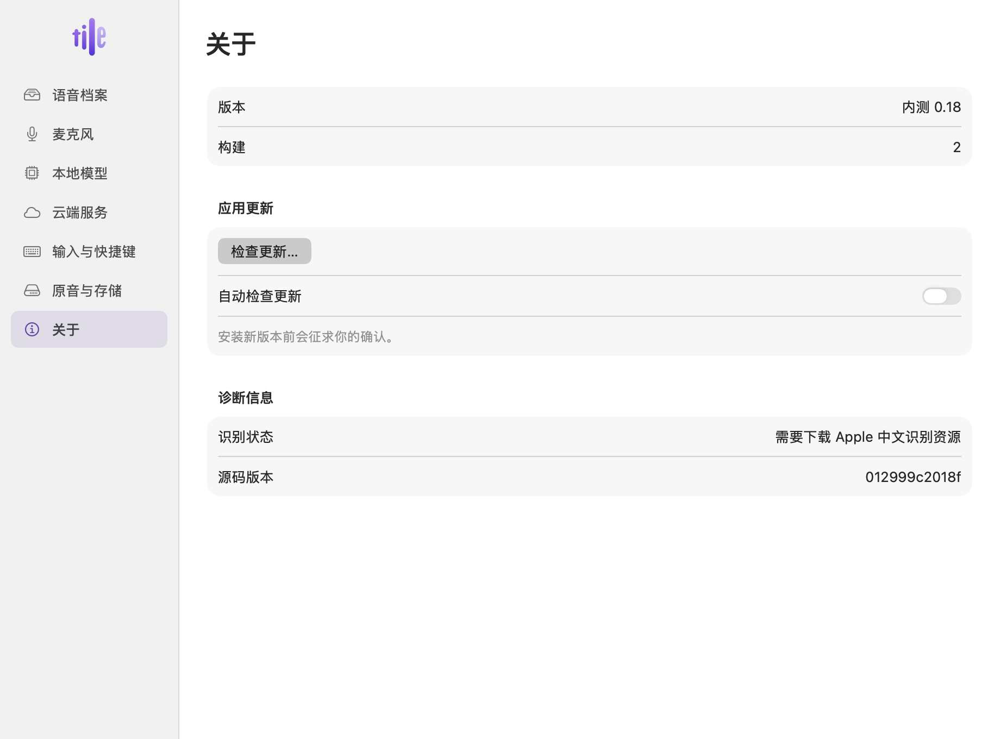

# Saytile 0.18（492）应用内更新交付

产品源码 `012999c2018f591f3cf9a529e4c0ae81e7b81f21`；[Draft PR #44](https://github.com/haohongfei2001-png/saytile/pull/44)，继承 PR #43 / 已安装 0.17（488）。本证据提交不改变产品源码 SHA。

## 使用

菜单 → 检查更新，或语音档案与设置 → 关于 → 应用更新。默认每天检查，可关闭自动检查；发现更新不会抢焦点、暂停收音或自动安装。用户确认安装后先完成现有原音/草稿保存，再由 Sparkle 校验并安装、重启。主语音板不增加任何控件或状态。

Saytile 独立 Ed25519 密钥仅保留 Keychain；仓库只有公钥。正式与当前中文候选使用不同的签名 feed，防止跨身份替换。当前 feed 为空：实际检查反馈“暂无可用更新”，并不代表已有新公开发行。本轮未合并 main、未提交公证、未公开 App 发行。

## 实际验收

| 项目 | 结果 | 范围 |
|---|---|---|
| 原生宿主更新闭环 | PASS | 最终产品二进制的临时签名身份，构建 1→2；真实 SPUUpdater 下载、安装、正常退出、无参数重启、新 PID；用户选择由隔离确定性 driver 提供 |
| 损坏安装包 | PASS | 同长度/签名下改变一个字节，Sparkle 4005 拒绝，版本和数据保持 |
| 真实设置按钮 | PASS | 正式 SettingsView 的唯一启用 AXButton，AXPress 实际发起 HTTPS feed 查询；前台未改变；原生截图随附 |
| 数据保留 | PASS | 2 条合成录音、4 版文字、2 份未完成草稿、2 个星标、2 条投递账本、原音 SHA-256、段落元数据、偏好 canary、缓存标记与 mtime |
| 升级回退 | PASS | 488→492→488→492，同源签名包；SQLite v6、自然段元数据、原音哈希、版本和草稿保持 |
| 更新配置 | PASS | Swift Testing 7 项，Python 打包配置 18 项；签名失败不降级、仅前进版本、渠道绑定、隐私设置 |
| 独立代码复核 | PASS | 无新 P0/P1；3 处更新提示 P2 已修复，见 REVIEW.md |
| 最终 CI | PASS | 5/5；Xcode 26.6，532/532 Swift Testing、183 AppModel、18 打包配置；无失败断言跳过 |
| Developer ID 签名 | PASS | App 与 DMG，Team ZB9D4T66QB |
| Gatekeeper / 公证 | BLOCKED | Unnotarized Developer ID；未绕过策略、未提交公证 |
| 标准 Sparkle 弹窗逐按钮操作 | NOT_RUN | 原生安装驱动为确定性测试 driver；不冒称标准窗口人工点击 |
| 当前正常录音中点击安装 | NOT_RUN | 本轮全为隔离合成资料，不读取用户原音；安全退出代码保持不变 |
| 物理麦克风 / 新 ASR 质量 | NOT_RUN | Mac 按要求合盖；运行库逐字节沿用 484，不宣称识别或 CPU 改善 |

原生设置截图中 build 2 和关闭自动检查属于独立升级 fixture。真实交付包是 0.18（492），默认自动检查开启。图中识别资源提示来自空白隔离偏好，不能推断用户实际引擎状态。

## 早期失败与修复

`c8d9ee2` 的隔离路径比较把 Foundation 的 /tmp 别名误判为不属于 /private/tmp，更新开始前退出；改为 POSIX 路径和目录属主验证。`3c7dba9` 的真实安装已经通过，但进程内 SwiftUI AX 遍历返回 0 个控件，整轮仍记录 FAIL；最终复用现有外部 AX 工具取得真实唯一启用按钮及回执，无放宽或跳过断言。早期收据原样保留在 earlier-failures/。

## 安装与恢复

DMG：`Saytile-0.18-mandarin-arm64.dmg`，64,972,638 bytes。SHA-256：`654b08e926d90c88e0cb05ff4a5c116aa6c87c6cd59f7d71c24ca028c0d5f933`。

本机交付目录：`/Users/hhf/Documents/GitHub/saytile/dist/in-app-updates-0.18-492/`。当前候选已在原路径原子更新并启动，492 的实际 PID 84511、签名和可执行文件指纹已核验，详见 activation.json。本次从未接通更新的488引导安装使用原子包替换；真正 Sparkle 安装链在隔离签名副本中验证，二者不混称。现有正式 0.12（373）不修改。旧 0.17（488）DMG保留，可安全回退；不需要关闭 Gatekeeper。公网上下载的未公证包可能被系统阻止，本机工程启动与正式分发验收不同。

后续获准发行时才签名并发布对应身份的更新项。构建号必须高于已分发最大值，不能直接以 squash 后更小的 git count 发行。用户资料不参与 feed/安装包，模型缓存不进入更新归档。
