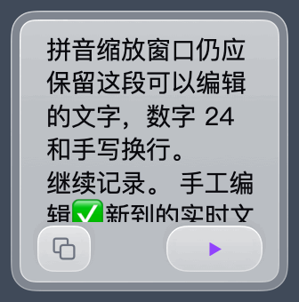

# 内测 0.10 连续缩放

安装及实测的产品源码为 `b2f2f4ce673ebf32be3adf672ea9593a73ed8484`，build 367。应用自 0.9 原位更新，签名经严格校验，仅一个实例运行。[安装收据](installation.json)

在同一台 Mac 上向原生窗口发送 520 个逐点拖动事件。左边缘先向右 128 点，上边缘再向下 132 点，之后依次反向拖回。每四点采一次实际视图，动图保留 134 帧。端点停留便于观看，回放时间不用于计算显示器刷新率。[0.9 对照](before.json) · [0.10 逐点尺寸与采样时刻](after.json)

| 操作 | 0.9 | 0.10 |
| --- | --- | --- |
| 从 156 × 158 横向拖窄 | 高度到 80 点宽时跳至 44 点 | 可停在 28 × 158，高度、右边及底边位移均为 0 pt |
| 固定 28 pt 宽，向下拖上边缘 | 此宽度不可达 | 可到 28 × 26，拉回能恢复 28 × 158 |
| 轻点窄长板上方正文 | 旧紧凑窗口将整板作为语音键 | 正文接受编辑，只有底部原有音控范围可触发 |
| 从最小板拉开 | 经过界线会一次性取回先前高度 | 回拉时每条边按指针移动，按钮边缘有 3 pt 轻点容差 |

147/147 项隔离原生视图与鼠标事件检查，30/30 项手势及重启检查通过。菜单展开中可以接手拖动。中文输入法组合文字在缩至最小再展开后只提交一次。[手势](gestures.log) · [54 pt 窄板](control54.png) · [28 pt 窄板](tall28.png) · [最小端点](minimum-recognizing.png)

正式可执行文件用临时身份启动，实际菜单执行 12 次操作。两种旧记录、28 × 26、54 × 218 及 208 × 32 都能按保存的尺寸冷启动，并通过菜单恢复阅读尺寸。收音保持暂停，两个测试数据库都没有录音。[实际菜单记录](status-menu.log)

菜单跨重启和本机 Swift 测试的首次受测构建为 `d427786`，与最终公开源码具有完全相同的 Git 根树；最终签名包直接使用公开提交重建，原生视图、手势和安装收据均绑定最终公开提交。Swift Testing 分进程完成 4 + 456 项；回环服务审计 52 个情景，无协议违反。动图及按钮声级来自隔离合成状态。28 × 26 是根据参考照片的相对尺度选择的逻辑尺寸。
