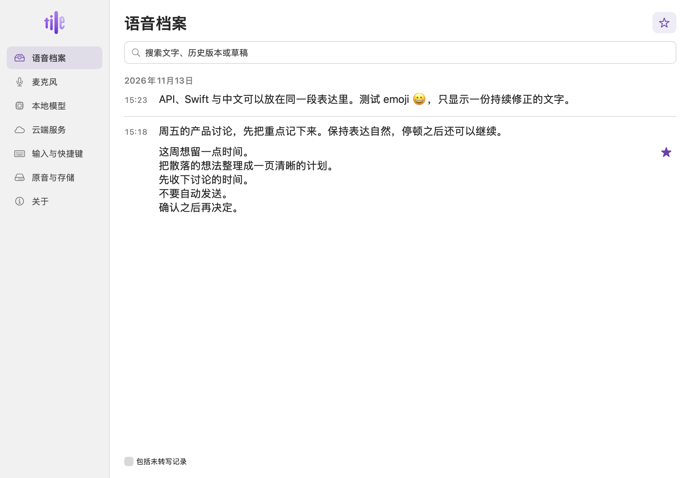

# 内测 0.11 · 语音档案与中断恢复

档案按讲话开始时已经保存的日期和时间组排版。短暂停顿继续同组，从上一句**讲完**起默认安静 120 秒才另立时间。只修改呈现，不重切旧录音或重写原始时间戳。旧的手选间隔继续有效。星标、回听及历史版本仍关联原段。

每次音频检查点请求磁盘刷新。SQLite 使用 WAL、FULL 同步及 macOS 物理刷新；先提交识别文字，再交给输入板显示。档案正文的已确认输入及详情草稿也写入本机。设备没有提供物理刷新时，原音使用支持的同步方式。没有硬件或软件可以找回未进采集缓冲、尚未识别或未来得及写盘的内容。

- 旧实现故障复现：[零帧登记与损坏空尾文件](before.json)（隔离合成原音；真实进程终止）。
- 物理断电：**NOT_RUN**。无外部 ASR 调用；没有读取个人原音、文字及剪贴板。

签名安装版本为内测 0.11 build 369，源码 `3b10cc5859b14e19a75dedbb3a264dd139183c0d`。已从 0.10 正常退出并原位更新，启动后只运行一个实例。未公证或发布。[安装收据](installation.json) · [测试摘要](checks.json)

- **原生窗口 PASS：** 同一组两条讲话正文、另组一个新标题；鼠标单击直接放置光标并写入正确记录。空白段、拼音确认、选区、复制粘贴、撤销重做、Tab 前进后退、播放与停止、按段查看版本及跨进程重开星标通过。[编辑态截图](archive-editing.png) · [签名窗口机器记录](native.json)
- **禁网中断 PASS：** 系统阻断测试进程所有网络（含回环），18 项存储检查通过，包括 6 次真实 SIGKILL。未满首秒的 4,000 帧和换块前的 240,000 帧可恢复，已显示的临时转写与人工改稿保留；两次重开没有重复。旧版迁移及原音删除语义也通过。[存储机器记录](storage.json)
- **回归 PASS：** 464 项 Swift 测试（4 + 460，0 失败）；152 项 AppModel 检查；本机回环协议 52 情景，无协议违反。包括 120 秒边界、长句结束时间、分页和旧草稿基准不明时的冲突保护。原有用户数据不作为此验收的测试素材。
