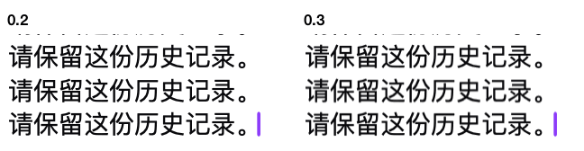

# 内测 0.2 与 0.3 的原生文字流回放

左侧为 0.2，右侧为 0.3。动图采自各自实际 AppKit 编辑器的可见文字区，展示同一份多行追加及数字更正。两段画面按事件时钟对齐，正常速度播放。每版单独再跑一次测量，避免画面采集影响定量结果。



| 同一台 Mac、同一批候选、同一窗口 | 0.2 | 0.3 |
|---|---:|---:|
| FLEURS 既有中文回放，观测到的文字变化 | 20 次 | 36 次 |
| 最大相邻采样视口位移 | 19.0 pt | 3.8 pt |
| 单次显示的净增字符上限 | 6 | 4 |
| 首条候选提交至尾字进入可见区 | 8.6 ms | 9.6 ms |
| 相邻文字变化的最长间隔 | 925 ms | 911 ms |
| 多行突发及修正，观测到的文字变化 | 4 次 | 7 次 |
| 最大相邻采样视口位移 | 74.0 pt | 14.5 pt |
| 单次显示的净增字符上限 | 45 | 25 |

测试加载产品提交 `2a0e566f6cb1b8921b8dfaf517672e4ebaa371f1` 和 `d80a537f6038674e8755c47bbde0b28c90e6684c` 的 `VoiceSurfacePanel`，在独立、非激活的原生 `NSPanel` 内显示。两版都使用 167 × 98 pt 窗口与 2× 显示比例，文字可视区同为 154.5 × 65 pt。FLEURS 样本 ID 为 `fleurs-9eb2d543a0a36152-quiet`，输入是仓库已有的已发布候选和原始间隔，省去首条前的静音。多行突发为人工构造的确定性压力样例。

**PASS**。两种场景在两版上均准确收敛到相同定稿，每次中间显示都有已收到的候选前缀作为依据。选区及其视口位置在后台更新时保持，独立剪贴板保留复制快照，原生键入只提交一次并完整显示。两版窗口均未成为键盘焦点。0.3 将多字追加分散到更多显示帧；试验中接近一秒的上游出字间歇仍然可见。

采样读取 `NSTextView.string`、末尾字形与可视区的交集以及 `NSClipView` 的实际位置。首条延迟以宿主送入第一条候选为起点。播放期间每轮目标采样间隔为 8 ms，逐次事件、派发时间、可见性与采样间隔均在收据中。此试验验证原生呈现路径；现场识别准确率和从开口计时的识别延迟须由端到端语音试验给出。

复跑时在一台带有图形会话的 Mac 中执行以下命令。可选 `--gif` 单独截取受控窗口文字区。脚本不会请求麦克风或写入系统剪贴板。

```sh
python3 scripts/test-transcript-motion.py --source 2a0e566 --output /tmp/saytile-old.json --gif /tmp/saytile-old.gif
python3 scripts/test-transcript-motion.py --source d80a537 --output /tmp/saytile-new.json --gif /tmp/saytile-new.gif
```

逐次测量请参阅 [0.2 收据](viewport-old.json) 和 [0.3 收据](viewport-new.json)。
