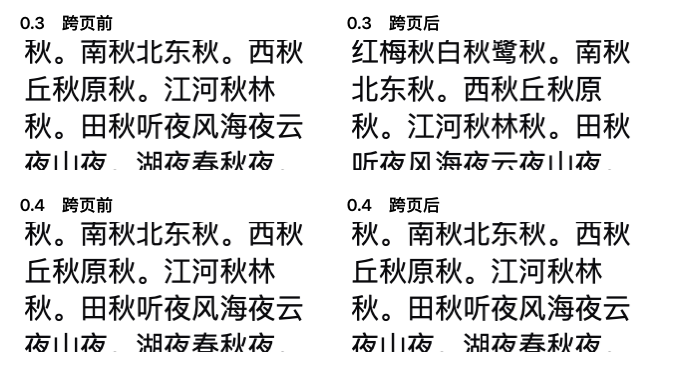

# 内测 0.4 手动阅读与分页验收

旧版 `d80a537f6038674e8755c47bbde0b28c90e6684c` 为 **FAIL**。最终 0.4 `6d80c28e15ccd3946194837800bad03e7cf6fd50` 为 **PASS**。



每张图都是原生编辑器可见区域的实际绘制。上下两行使用相同的窗口、内容与第一笔触发换页的滚轮输入。此处换页时，这笔输入的位移已经走完，原来正在读的字应当留在同一位置。旧版换页重排了整行；0.4 的前后 PNG 字节完全相同。精确触控板事件的第一处换页也得到了相同的前后 PNG。

| 同手势回放 | 旧版换页数 | 0.4 换页数 | 旧版最大额外纵向位移 | 0.4 最大额外纵向位移 |
|---|---:|---:|---:|---:|
| 1–3 字短中文段，机械滚轮 | 12 | 12 | 27.68 pt | < 0.001 pt |
| 1–3 字短中文段，精确手势及动量 | 11 | 10 | 18.72 pt | < 0.001 pt |
| 中英混排、数字、标点、emoji、手工换行，机械滚轮 | 14 | 14 | 18.72 pt | < 0.001 pt |
| 同一混排，精确手势及动量 | 14 | 14 | 18.72 pt | < 0.001 pt |

每版各发出 1,206 个原生滚动事件。真实 NSPanel 内的产品 `CompactTranscriptScrollView` 接收机械行滚动与带有开始、变化、结束、反向和动量阶段的精确滚动事件。272 条独立测试记录经 64 条的重叠窗口分页。测试宿主在下一回合交付页面，单独采集替换前后的 `NSLayoutManager` 可见字形及其屏幕相对坐标，按原记录 ID 和 UTF-16 偏移对应同一个字。接受阈值为 1 个逻辑点。所有图像和坐标只取自隔离的本进程文字视口，不抓取桌面。

0.4 的 50 次页替换均能对应相同字形。扣除应由当前滚轮笔势继续兑现的距离后，可见字形最大纵向偏差为 `5.7e-14 pt`。短中文样例中每次换页的横向位移中位数，旧版最高为 70.2 pt，0.4 的所有页均为 0。切页后等速的下一笔普通手势、到达全局首尾后继续向外滚动、阅读历史时末尾修订的结果均通过 1 pt 阈值。四种测试均未成为活动键盘窗口。

本试验覆盖真实 AppKit 排版与滚动，手势由窗口局部构造并直接交付。它没有实测某一只物理鼠标或用户的手指，也未开启麦克风或访问用户资料。定量测量与像素采样分为两趟，避免截屏开销影响位移结果。

完整逐次记录见 [0.3](reader-0.3.json.gz) 和 [0.4](reader-0.4.json.gz)。执行以下命令可复核。

```sh
python3 scripts/test-reader-motion.py --source d80a537 --output /tmp/saytile-reader-old.json
python3 scripts/test-reader-motion.py --source 6d80c28 --output /tmp/saytile-reader-new.json --images /tmp/saytile-reader-pixels --expect-pass
```
