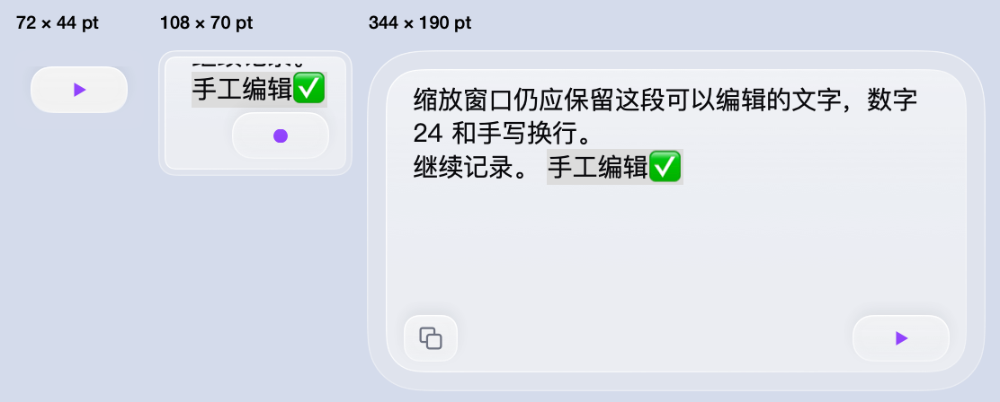

# 0.5 原生浮板缩放与交互

**PASS**　产品源码 `745acb2273d0512ce957a666364114cf36d663e7`，58/58 项断言通过。使用真实 AppKit / SwiftUI，单个非激活浮板从宽到窄再还原，覆盖 10 种外窗尺寸，所有尺寸均为 macOS 逻辑点。



| 实际外窗 | 显示与交互 |
|---|---|
| 344 × 190、178 × 90、178 × 64、128 × 82 | 正文 14.04 pt、复制 30 × 26、语音 54 × 26。改变宽度会重新折行，改变高度只增减可见行数。 |
| 108 × 70、81 × 58 | 固定字号的可编辑正文与语音按钮。窄态插入的文字和选区在展开后保留。 |
| 80 × 48、72 × 44、72 × 96 | 仅保留居中的 54 × 26 语音按钮。72 × 44 时左右及上下间隔均为 9 pt。 |
| 还原为 344 × 190 | 原 `NSTextView`、手工修改、选区与复制按钮均恢复。 |

- 极简态对唯一语音按钮执行本地 AXPress 两次分别暂停、恢复，再向实际控件中心交付 AppKit 鼠标按下和抬起事件，成功暂停。总计三次状态改变。
- 72 × 44 时，对按钮中心与四边内侧 2 pt 作真实 WindowServer 命中查询，5/5 均命中浮板。查询同坐标且排除浮板时，5/5 均命中自有底窗。之前完全透明的边沿在相同测量中会透传到该底窗。窗口没有抢占使用者的键盘焦点。
- 进入极简态主动释放编辑器的第一响应者；缩窄前选择的文字保留。极简期间送入一条新的隔离候选，展开并释放选区后显示正确。普通 108 pt 窄态开始 AppKit 中文输入法预编辑，改宽至 240 pt 后标记范围与临时内容仍在，输入汉字只产生一次正式编辑。

这里验证产品共享视图与独立宿主的相同玻璃包裹逻辑。图像来自窗口内原生视图实际绘制；并排对照统一使用蓝灰底，未读取屏幕其他内容。按钮触发的是隔离状态回调，候选文字为测试输入，未开启麦克风。本测项的读数见 [机器收据](receipt.json)，原始画面见 [72 × 44](minimum.png) 与 [恢复到 344 × 190](restored.png)。

```sh
python3 scripts/test-adaptive-panel.py --source 745acb2 --output /tmp/saytile-adaptive-verification --expect-pass
```
