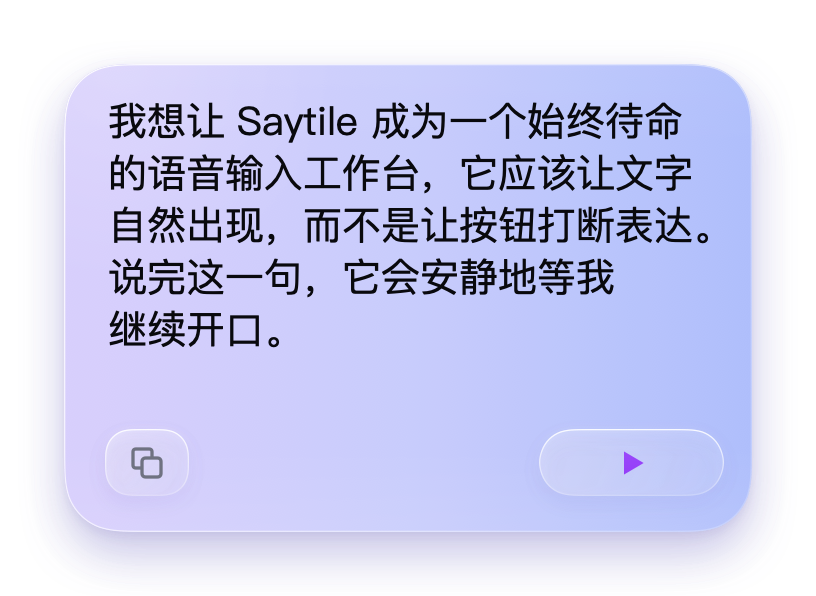
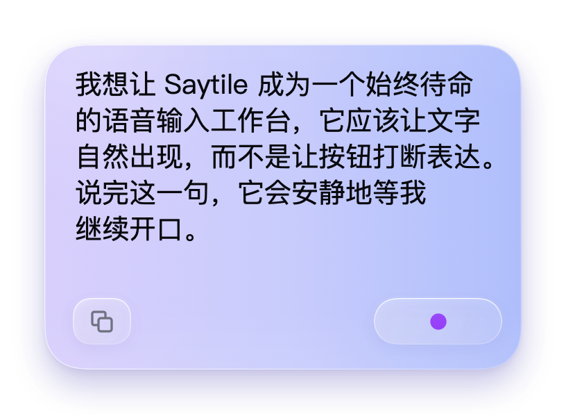
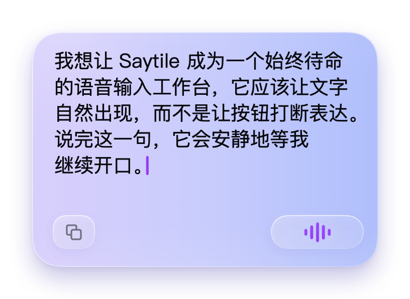

# Original-reference native window correction

Runtime: `e5b50d3f2be9c9e746787f03e03bf080bc16039a`. The three images are actual attached SwiftUI/AppKit renders of the shipping `InputPanelWindowView`, not an image-generator mockup or the reference pasted into the app. Transparent outer pixels contain its real rendered shadow. Reference text line breaks are an explicit test fixture; production remains selectable native live text.

| Paused | Standby | Recognizing |
|---|---|---|
|  |  |  |

## Executed verification

- Native UI/control script passed: 45 AXPress, 10 menu selections, 11 two-button inspections; text/Unicode/selection/scroll checks retained. 37 standard scenes plus 3 reference-sized window captures, and 71 sampled glyph frames.
- Window geometry: 11 tests passed using the repository's `scripts/test-native.sh`, which explicitly loads the CLT Testing macro plugin. A first direct `swift test` invocation lacked that plugin and failed to compile the test target; it was not counted as a pass.
- Three reference renders have a 344×234 pt card inside the 408×298 pt transparent-shadow window; the images are 816×596 physical pixels at 2×. [Measured source contract](../../design/approved/original-reference-20261107.measurements.json).

## Limits

This is synthetic capture-boundary verification, not physical microphone or cloud-accuracy testing. Typography, antialiasing, backdrop compositing and material are not claimed to be byte-for-byte identical to a raster design. No user acceptance is implied. Old no-api.7/.8 installers certify their own older source versions; they do not acquire this correction automatically.
