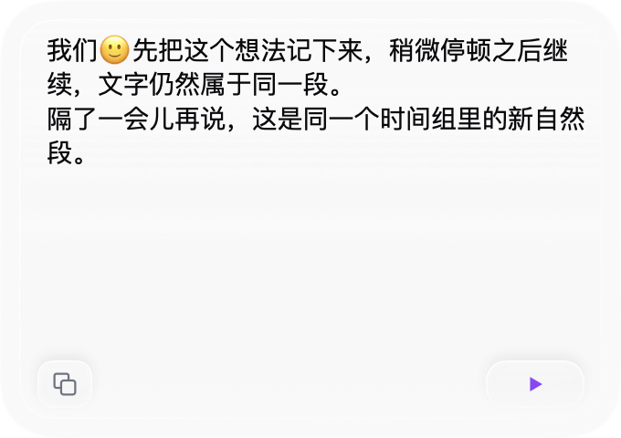
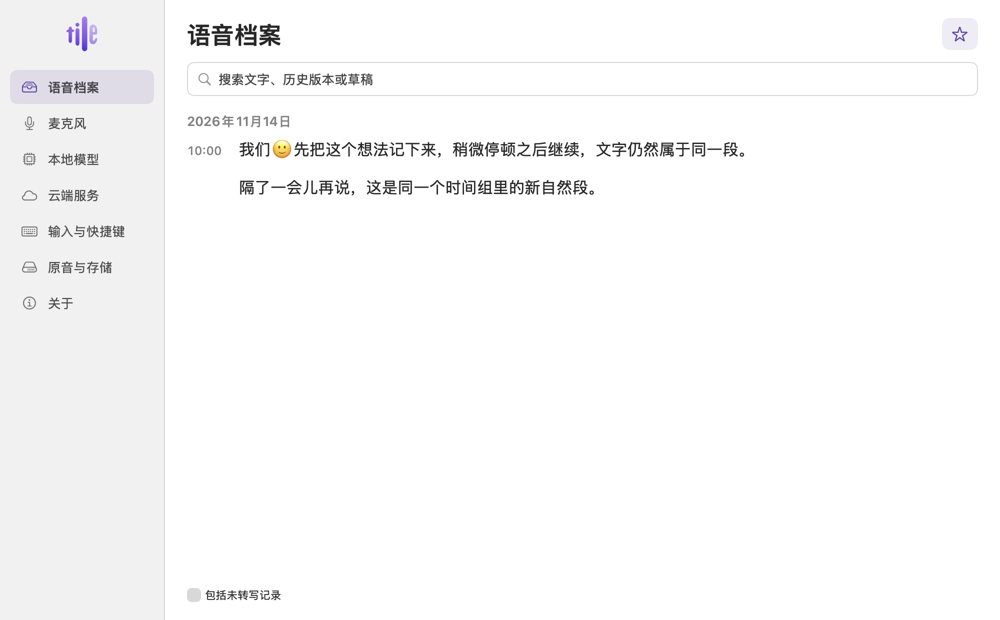

# 0.17（488）· 显示、档案与复制使用同一自然段

已在原路径更新并启动中文识别候选。语音板原来会把同一时间组的多个自然段一起复制；现在无选区只复制最新有文字、尚未清空的一段，有选区则立即复制选区。档案复用相同段落身份与取文方法。

- **产品源码**：`58bc8f96f79942881d1ae3221fd6219635833907`；基线是已安装 0.15（484）`ab8545507c79640ec3f419e33467a0263c154844`。
- [Draft PR #43](https://github.com/haohongfei2001-png/saytile/pull/43)，以 PR #41 自然段分支为基础，未合并。证据单独提交，不改变签名产品源码。
- ASR 源码和模型配置未变；Helpers、Frameworks、default.metallib 逐字节沿用 484。未混入未采用的 0.16 实验，不宣称本轮改善准确率、首字速度或 CPU。
- 沿用 **15 秒讲话间隔形成自然段、默认 60 秒形成时间组**。段落用于语音板显示、档案回听/收藏与复制；时间组用于时间组织。
- 一段跨多个录音和 64 条 UI 分页仍完整取用；点击固定末尾位置和清空边界；最新空白录音不会抢走复制目标。已复制内容不随迟到识别变化。
- 手工插入或删除换行保留排版，不重新分配原音与段落身份；不把每个人工排版行冒称独立档案。跨段取用可以选中文字。无选区回看历史时仍复制最新有效段。

## 同源验收

| 项目 | 结果 | 证据及范围 |
| --- | --- | --- |
| 旧产品复制缺陷复现 | FAIL，已修 | [原 AppModel 日志](regression/before-native.log)：同一时间组两段时误复制两段。 |
| 最终完整 CI | **PASS，5/5** | [收据](ci/summary.json)、[日志索引](ci/README.md)。525/525 Swift Testing、183 项 AppModel；无测试跳过、无依赖步骤跳过。 |
| 最终本机签名原生 | **PASS，22 项** | [收据](native/natural-paragraphs.json)、[日志](native/run.log)。3 次真实 panel.copy AXPress、emoji 选区优先、迟到修订后剪贴板不变；档案实际 NSMenu 复制、编辑/撤销/重做、段落收藏及连续回听/停止。 |
| CI 原生段落 | PASS，21 项 | CI 没有本机 AX 控制助手，按钮原生 AX 动作明确 NOT_RUN；不把 CI 的模型动作冒称真实点击。本机上一行补足实际 AX 检查。 |
| 长历史 | PASS | CI 12,000 条种子，最终 12,003 行，常驻 64 行；该次 wheel-to-paint 为 0.022513584 秒，仅为隔离虚拟 Mac 测量。 |
| 外部输入回归 | PASS | 同源 CI 的 AppKit、WKWebView、TextEdit 临时文档、Chrome 隔离 profile；首插入、追加、去重、目标/用户变化及零自动发送。 |
| 升级和回退 | **PASS** | [收据](rollback.json)：484 → 488 → 484 → 488。2 条记录/2 份 WAV、4 个版本、2 个编辑草稿及派发记录等值，原音哈希不变；SQLite v6、段落 sidecar v2、隐藏段界、自定义 180 秒设置保留；空库启动通过。 |
| 原位更新与启动 | **PASS** | [安装收据](activation.json)：旧实例正常退出，原子交换候选 App，启动后 PID 66677；源码、签名和运行入口核对通过。正式 0.12（373）指纹不变。 |
| 独立代码审查 | PASS | [审查](REVIEW.md)，未发现本次新增 P0/P1。非阻塞建议为增加 AppModel 非空清空边界用例，存储层已有覆盖。 |
| Developer ID 签名 | PASS | [包收据](package.json)，App 与 DMG 验签通过，Team ZB9D4T66QB。 |
| Gatekeeper 公开分发 | **BLOCKED** | `Unnotarized Developer ID`，exit 3；未公证、未绕过系统检查，不是正式公开发行。 |
| 本轮麦克风 / ASR 质量 / 云端 | **NOT_RUN** | 用户要求继续合盖；本轮未改 ASR，不用静音夹具冒充讲话。未调用付费服务。 |

本机交互使用独立合成文字、4 个静音 WAV、私有剪贴板和自有非激活窗口。截图由 AppKit cacheDisplay 捕获真实视图，不是桌面截屏、HTML 或真人讲话证据。档案复制实际派发 NSMenu 动作，不冒称鼠标点击。升级测试使用临时数据库，网络被禁止；Keychain 只检查服务名契约，没有读取密钥。

## 保留的失败与限制

1. 首轮验收的 emoji 选区正确固定了历史阅读位置，随后场景却等待新记录：测试程序通过正常“回到最新”动作复位，未改产品阅读保护。[失败日志](regression/first-signed-fixture-failure.log)。
2. `e4407fd3` 本机原生回听停止检查遇到 alpha=0 的验收窗口从系统 AX 列表消失。最终源码使用既有的屏外、可绘制、不能 key/main、忽略鼠标的验收窗口；产品窗口与播放器未改，最终 22 项全部通过。[原失败](attempts/e4407fd3/native-failure.log)。
3. `8ffa4461` CI 曾有 Chrome `switch-target-bind targetChanged` 和运行库准备退出 141，原因仍为 **NOT_ROOT_CAUSED**。[失败证据](ci-failed-8ffa4461/)。随后仅增加脱敏诊断，未放宽所有权约束、读次数、期限或重试策略；三组固定归档管道各三次本机均 0/0。`e4407fd3` 与最终 `58bc8f96` 均 5/5 通过，不能据此宣称旧间歇失败根治。
4. CI 硬件睡眠 BLOCKED，物理双屏和真正原生全屏 NOT_RUN；不以虚拟机或窗口大小模拟替代。设备资源、个人口音与长时 ASR 能力沿用原版本证据，本轮没有重新证明。

先行 183 项 AppModel 和 18 项相关 Swift Testing 属于 `570fd0a…`，保存在 [regression](regression/)。最终完整结果以上表最终源码 CI 为准。没有降低失败断言或将失败项改成跳过。

## 原生对照

同一个时间组内有两个自然段，语音板复制只取第二段；档案第二段复制相同文字。保持既有语音板控件和视觉。

## 安装包和回退

- 已运行入口：`/Users/hhf/Applications/Saytile 中文识别候选.app`，0.17（488）。
- DMG：`dist/paragraph-copy-0.17-488/Saytile-0.17-mandarin-arm64.dmg`，**63,761,942 字节**；本地保留，不上传为公开发行包。
- DMG SHA-256：`831059554040385710dfdd1f6c60048a2bad98f167184fc244490fe6f1bbfbf8`。
- 旧 484 DMG 保存在 `dist/natural-paragraphs-0.15-484/`；如需回退，正常退出候选后以该包恢复同一路径，保留同一资料目录。升级回退已用合成资料验证，未读取用户真实档案作测试。
- 候选 Bundle ID、资料目录与 Keychain 服务名不变；安装仅交换 App 文件。正式 App、main、Nearpane、iCloud 独立成果未改。
- [运行库字节核对](runtime484.json)、[构建日志](build.log)、[机器总收据](machine.json)、[最终 CI](ci/summary.json)、[原位安装收据](activation.json)。

本轮已经交付自然段复制修复。此前提出的识别响应与 CPU 优化仍以单独 ASR 对照结果决策；本包不把未证明有效的实验改动交给用户。
