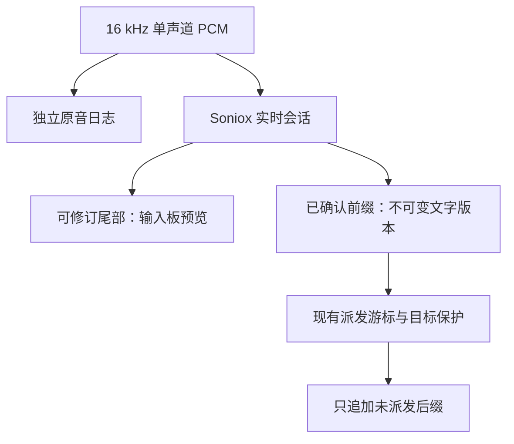

# Saytile ASR 最终技术裁决

**日期：2026-11-06。状态：选型与开发方案已确定；云端接入与发布验收尚未执行。**

本文件服从用户最后的方向调整：利用成熟技术与现有证据尽快提升产品，不再扩建公共 ASR benchmark。当前 RC1 / `main` 的生产引擎、安装包及用户数据均不在本研究 PR 中修改。开发入口是 [IMPLEMENTATION.md](IMPLEMENTATION.md)，证据清单是 [VENDORS.md](VENDORS.md)。

## 1. 唯一主方案

**下一开发版本采用 Soniox `stt-rt-v6`，由同一个实时模型提供可修订预览与不可再修订的稳定文字；Apple SpeechAnalyzer / SpeechTranscriber 保留为离线备用。不默认增加第二个高精度定稿模型。**

| 决策项 | 执行结论 |
|---|---|
| 实时云端主引擎 | Soniox `stt-rt-v6`，官方 WebSocket 协议；Swift `URLSessionWebSocketTask`。 |
| 中文、英文、中英混说 | 一个多语言会话，`language_hints: ["zh", "en"]`；不先做逐句语言分类、再路由不同模型。 |
| 实时显示 | provider non-final 部分可被整段替换，只作为预览。 |
| 外部输入与定稿 | 仅 provider 已确认的连续前缀可增量派发；最终文字仍由同一引擎完成。 |
| 自动二阶段识别 | 不实现。没有证据表明在 Saytile 的追加式输入约束下，逐句双跑能改善实际送入目标应用的文字。 |
| Apple 定位 | 保留本地与故障备用；不再作为质量优先、已启用云端处理用户的长期默认。纯英语备用必须允许选择英语 locale。 |
| 大陆网络替代候选 | 仅保留 Qwen `qwen-audio-3.1-asr-flash-message`。只有 Soniox 实际网络验收不满足时，才启动该替代接入；不同时接入五家。 |
| 可选高精度文件识别 | ElevenLabs `scribe_v2` 仅列为将来“用户主动重新识别原音”的候选，尚未批准接入，也不作为本方案的后台定稿器。 |

这是一项**证据约束下的产品工程选型**，不是“Soniox 最新版已经在所有中文、混说、数字和否定词上获得全球第一”的实验结论。最新版本覆盖不足时仍可以作出开发决策，但不能编造其准确率。

## 2. 为什么选 Soniox，而不是按品牌或单一榜单决定

### 实时能力已有外部证据，协议也适配 Saytile

[Pipecat 开放评测](https://github.com/pipecat-ai/stt-benchmark) 在 1,000 条 smart-turn 样本上公布：Soniox **`stt-rt-v5`** 的 pooled semantic WER 为 **1.09%**，返回率 **99.8%**，TTFS 中位数 **260 ms**、P95 **305 ms**。同表的 Scribe v2 Realtime 为 3.13% / 281 ms，旧 `gpt-4o-transcribe` 为 2.95% / 637 ms。这支持 Soniox 家族具备有竞争力的实时质量与完成速度。

这些数字有四个限制：测的是 v5；semantic WER 由语言模型按语义计分，并非严格逐字错误率；TTFS 是停声后最终片段到达时间，不是首字时间；页面不能提供普通话、中英混说、数字或否定词的独立分项保证。开放社区结果也不是所有供应商由同一中立实验室重新测出的排行榜。

[Soniox 官方流式协议](https://docs.soniox.com/stt/rt/real-time-transcription) 明确区分不可变 final tokens 与可替换 non-final tail。它可以直接映射到 Saytile 已有的“稳定前缀追加一次”契约。无需为获得实时预览另接一个模型，再等待另一个模型改稿。这是选择它的工程依据，不是准确率宣传。

官方 [模型目录](https://docs.soniox.com/stt/models) 显示 v6 于 **2026-11-03** 发布，v5 已进入弃用流程。新开发锁定受支持的 v6；官方关于 v6 更强中文、数字与混说的陈述仍按**厂商声明**处理，不能把 v5 的独立分数直接标成 v6 的成绩。

### 中文公开证据支持“值得选择”，不足以证明绝对胜出

[Verli 2026-07-19 的逐语言测评](https://verli.app/blog/per-language-speech-to-text-accuracy) 使用每语言 200 条 FLEURS 朗读语音。其中文 CER：ElevenLabs Scribe **4.17%**、OpenAI GPT-4o Transcribe **4.46%**、Soniox **4.71%**。Azure 为 4.07%，但该文报告其部分语言请求覆盖率仅 94–97%，不能忽略未返回结果再宣称完胜。

这项资料来自转写软件开发者，是引擎厂商之外的可检查测评，也存在其自身商业背景。它不是自然中英混说测试，不覆盖全部当前型号；Scribe 的文件识别分数不能移植到 Scribe Realtime，更不能证明每段增加 Scribe 就能提升外部输入质量。差距不足以在缺少置信区间、同代版本和场景覆盖时宣布中文唯一冠军。

### 没有可诚实引用的完整“当前模型中英混说总冠军”

[Perle code-switching benchmark](https://perle.ai/benchmark/asr/) 的语言对不是普通话—英语。[ServiceNow 的 code-switching 研究](https://huggingface.co/blog/ServiceNow-AI/code-switching) 也没有普通话，且使用合成音频。它们不能替代 Saytile 的中英混说证据。[Artificial Analysis 方法说明](https://artificialanalysis.ai/methodology/speech-to-text) 对实时与非实时的区分有价值，但其主要语料与汇总分数同样不足以解决上述缺口。

因此，普通话、英语、混说统一选 Soniox，是结合多语言功能、实时外部证据、稳定结果协议和集成风险作出的**工程推断**。对专业术语、数字、否定、重复及漏词，不提供未经验证的精确优劣排名。

## 3. 其他候选的裁决

| 候选 | 不作为当前主方案的原因；保留价值 |
|---|---|
| OpenAI `gpt-live-transcribe` / `gpt-transcribe` | 是应核验的当前型号，不能继续把旧 GPT-4o 或 Whisper 代表全部 OpenAI。现有可比证据不足以证明新型号在目标语言与追加式输入上优于本方案；实时 PCM 还需适配 24 kHz。品牌和通用大模型能力不构成 ASR 胜出证据。 |
| Qwen Audio 3.1 ASR Message | 面向语音输入并提供句末修订，适合大陆部署条件；北京 Workspace 接入明确。尚无本研究所核验的同代、同场景中英混说独立胜出证据，修订结果也不能未经稳定性确认就输入外部应用。保留为网络约束触发的替代候选。 |
| 豆包流式 ASR 2.0 | 有成熟正式接口，国内部署有价值。没有取得足以改变本次主选的、可核对的当前版本混说与关键实体比较证据；不以“中文厂商必定中文最好”代替数据。 |
| ElevenLabs Scribe v2 Realtime / Scribe v2 | 文件识别有良好外部证据；实时版本是另一个模型。先不增加第二条供应商链。将来若需要更好的档案重转写，可只评估用户主动触发的 Scribe v2。 |
| 本地 Qwen3-ASR-1.7B | 本轮已完成小样本直接识别，表现优于当前 Apple 配置；但它不是 Qwen Audio 3.1 云服务，也没有完成符合 Saytile 要求的稳定实时接入。首版不增加约 4 GB 模型分发、MLX 推理与持续资源管理。 |
| Apple 原生 | 离线、系统集成与故障备用仍有价值；固定中文配置不满足英文和混说目标。保留其正确语言模式，停止把它当作质量上限。 |

现行模型、鉴权、API 和各类证据的来源见 [VENDORS.md](VENDORS.md)。

## 4. 已完成的本地结果如何影响决策

在用户调整研究方向前，已经完成并保存了 **112 条合法真人音频 × 3 组直接识别 = 336 条输出**。无需再下载或重做。下面只列每类 32 条 primary 的严格错误率；16 条 challenge 没有混入主表。

| 原音直接识别 | 中文 CER | 英文 WER | 中英混说 MER |
|---|---:|---:|---:|
| Apple，生产同款固定 `zh-CN` | 120/1041 = **11.53%** | 480/644 = **74.53%** | 122/508 = **24.02%** |
| Apple，按参考语言指定 locale 的诊断对照 | **11.53%** | 61/644 = **9.47%** | **24.02%** |
| 本地 Qwen3-ASR-1.7B BF16，自动语言 | 71/1041 = **6.82%** | 36/644 = **5.59%** | 61/508 = **12.01%** |

这些数据首先证明**固定 `zh-CN` 是英文的明显配置缺陷**，其次说明 Apple 不是不可替代的准确率上限。它们不证明 Soniox 或任意云端服务在这批音频的表现，也不证明 Qwen 托管 3.1 的表现。

所有结果绕过生产 WebRTC VAD；样本少，语料风格不均，未逐条人工重新听审上游文字；严格评分不合并繁简与数字表达。Apple 固定中文有 1 条结果未完整 final，不能写成全部完成定稿。旧关键实体计分采用子串匹配，不能用于严肃的否定词/数字安全排名。完整分子分母、文件与限制见 [LOCAL_EVIDENCE.md](results/LOCAL_EVIDENCE.md) 及 [summary.json](results/direct/summary.json)。

方向调整后已主动停止 Whisper 扩展运行，保留 55 条中间结果，不纳入完整横向排名。没有因缺少云端密钥把本地输出冒充云端实测。

## 5. 架构：一个引擎的两种文字状态

一个模型输出预览与稳定文字，不等于两个模型的串联定稿。用户可以早看到文字，外部应用只收到稳定部分。

若第一遍已经把“可以”输入外部软件，第二遍改成“不可以”，只有重写外部文本才能纠错。Saytile 现有契约禁止自动重写已派发内容。若让第一遍只预览、全部等第二遍，才可能提升最终输入准确率，但会增加等待、服务依赖与故障协调。目前没有匹配实验或公开证据证明此代价值得作为默认。

这项决定不以节省推理费用为前提；缺少的是对实际可派发文字的净收益证据。

因此不做模型投票、不逐句双跑、不让 LLM 根据旧转写猜测原话，不启用自动润色、翻译或事实补全。数字与否定尤其应保持原话；格式变化与语义错误必须分别记录。

## 6. 先修产品实际限制

[PRODUCTION_AUDIT.md](PRODUCTION_AUDIT.md) 对现行源码进行了审计，小范围边界检查结果独立记录，不冒充完整 ASR 横评。

Mac 实机已经完成三个目的明确的检查：7.9 秒原片段完整保留；同片段重复至 79 秒，实际跨过两次 30 秒强制边界，输出逐样本吻合、无遗漏/重叠；活动短尾的 43 个样本由 `finish()` 正常输出。它们验证当前切段控制流，不是自然长句的识别准确率测试。见 [原始报告与复现方式](results/vad-probes/README.md)。

- **固定中文语言策略**：云端统一多语言；Apple 备用提供明确的中文/英文选择，不假设 Apple 已解决无缝混说。
- **30 秒识别上下文重置**：云端模式不再按此时钟拆录音与识别会话；15 秒原音文件轮转保留。普通接缝不能仅凭源码认定丢音。
- **两套 endpoint 不互相截断**：provider 负责文字稳定；本地静音只负责结束逻辑录音与回收连接。云模式先用 2.0 秒本地静音关闭阈值，作为工程初值，并非实测最优或文字发布必须等待的时间。
- **慢定稿不能阻塞收音或被任意淘汰**：结束输入后异步 drain；达到并发/超时边界时保留原音并排队，而不是因为已有两个新段就取消最早结果。
- **单一发布权**：每条 recording 仍只有一个 RecognitionTicket。复用现有 Store API、不可变版本、音频 epoch、稳定 UTF-16 游标和目标绑定保护。

仍保留 WebRTC 的触发门槛和 1 秒预卷。未触发 VAD 的短声段可能从未落盘，此研究没有证明云模型可以恢复未发送的音频，也不凭猜测调低所有门槛；轻声专项仍不是本轮扩展目标。

## 7. 能承诺什么准确率和延迟

**目前不能给出 Saytile + Soniox v6 的实测 CER / WER / 中英 MER、首字 P95 或大陆网络 P95。** 本轮没有可使用的 Soniox / 其他云 ASR 授权密钥，没有开通新付费服务，没有执行云端调用。

可以引用的只有：上述有边界的公开旧版本结果，以及已经完成的本地小样本结果。外部测评的 260 ms 是停声后的最终片段时间；不能写成 Saytile 首字 260 ms，也不能把 `1 - WER` 简化成产品“准确率”。现有 Apple paced 文件回放也不能代表完整麦克风—VAD—网络—目标输入的端到端时间。

实施时独立记录三个时间：首个可读预览、首个可派发稳定前缀、最后真实语音结束至最后定稿。另记连接建立、cold/warm、失败率与网络地区。验收阈值是产品发布门槛，不是当前实测成绩。

## 8. 唯一上线前验证与条件备选

只验证公开评测无法替产品回答的问题：**v6 当前接口是否按契约工作、既有难例是否改善、实际网络是否足够快、是否完整保存与正确追加。** 使用已有 12 条短真人回放及必要的已有难例，最多 20 条、总上传音频预算 15 分钟（含重试），不得另建大规模榜单。具体要求在 [IMPLEMENTATION.md](IMPLEMENTATION.md)。不要求用户现在录音。

Soniox 官方 [地域文档](https://docs.soniox.com/data-residency) 列出美国、欧盟、日本与印度；没有大陆区域保证，区域权限也不应假定已经开通。以实际授权项目的地域与对应端点为准，不自行跨区上传。如果目标网络未通过上述小范围验收，**不发布 Soniox 为默认，也不为此架设复杂多厂商自动路由**；改用唯一保留候选 Qwen Audio 3.1 Message，复用相同的适配与派发契约，并先核验其最终事件。

这不是要求用户在多个方案中重新选择：Codex 现在只实现 Soniox。缺少服务凭据影响真实连接验收，不影响适配器、协议 fixture、队列与存储契约的开发。RC1 在候选通过之前继续可用。

## 9. 开发边界与完成定义

本研究交付的是明确选型、代码审计、已完成证据和单一接入说明。**研究完成不等于生产云端引擎已经部署。** 后续实现 PR 只接入一条云端主路径；保持独立原音、文字版本、稳定派发、不重复输入和输入目标保护；不迁移个人数据、不把实验默认覆盖 RC1、不新增词库系统或自动润色产品。

Codex 按 [IMPLEMENTATION.md](IMPLEMENTATION.md) 的顺序实现并提交候选，保留每个阶段的可回退提交与准确测试记录。没有必要再开一轮“全球 ASR 排名研究”。
