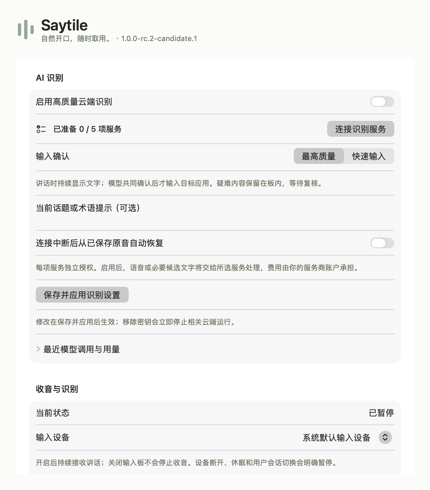
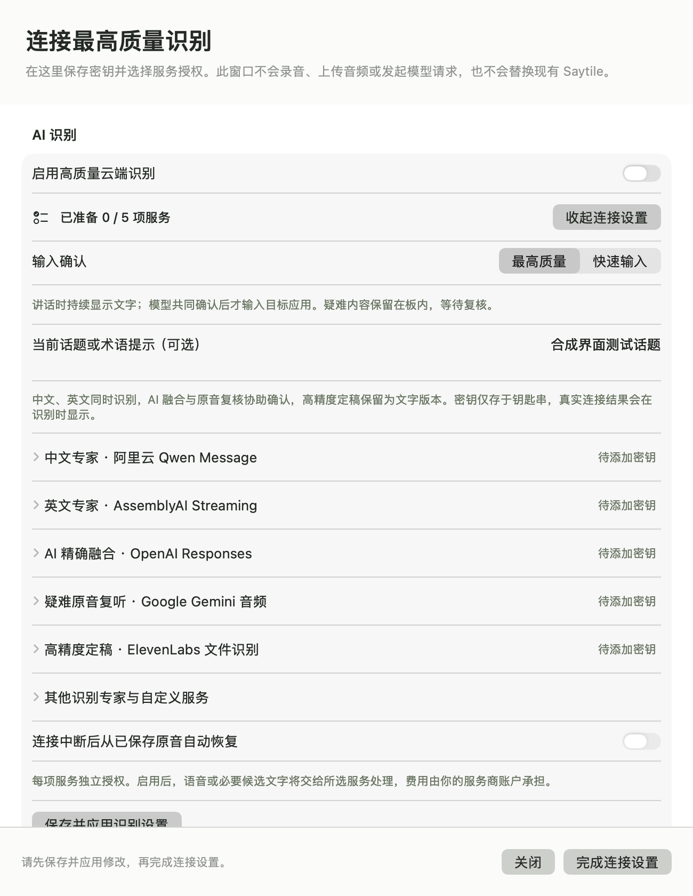
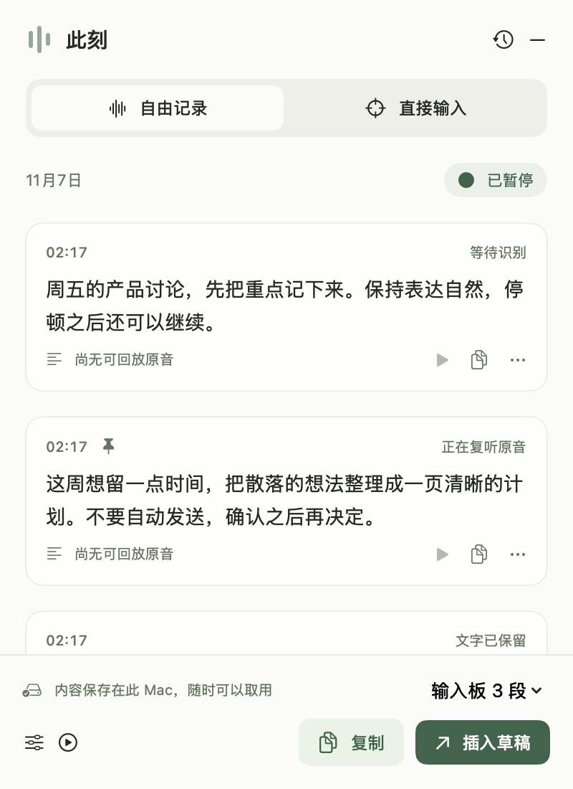

# RC2 engineering evidence — 2026-11-07

Candidate `1.0.0-rc.2-candidate.1`, clean runtime source `8f2d71b73c8ae1aa421719201a263de20d98fc7f`. Later evidence/test-script commits do not change this runtime. See `delivery-manifest.json` for exact artifact paths and SHA-256. Main and the installed RC1 are unchanged. Cloud provider calls and uploads remain zero.

| Evidence | Result and scope |
| --- | --- |
| `native-all.log` | 270 Swift Testing cases / 32 suites. Production logic, SQLite, capture journals and injected external transports; not cloud authentication. |
| `app-model-all.log` | 23 AppModel checks; same AppModel source as candidate. |
| `credentials-settings-review.md`, `credentials-tests.log`, `pipeline-review.md`, `upgrade-input-review.md`, `connection-setup-review.md` | Scoped engineering reviews and isolated synthetic Security.framework CRUD; not real provider connection. |
| `capture-ownership-before.log`, `capture-ownership-after.log` | Two P1 cancellation ownership races actually reproduced and repaired; independent reviews retained. |
| `ui-final-manifest.json`, `ui-controls-final.log` | Clean packaged binary: 15 actual SwiftUI/AppKit scenes; 6 native interaction groups; 16 AXPress, 2 AXSetValue plus 2 owned native field-editor commits. Candidate never activated. One outside foreground transition was recorded without attribution; does not prove foreground stayed fixed. No global keys, microphone or private app contents. |
| `connection-setup-cli-final.json` | 7 actual packaged executable rejection cases, before Store/window; production root and descendant rejected. |
| `cloud-probe-cli-final.json` | 4 actual packaged executable isolation cases; no audio imported or network calls. |
| `install-upgrade-final.json`, `.log` | 8 checks using actual released RC1 DMG and this clean RC2 DMG, disposable installation, synthetic archive; exact audio/version/draft/dispatch retention, old app rejection and explicit preupgrade copy rollback. No production install/database. |
| `input-regression.json`, `input-regression-review.md` | 9 actual native AX checks, 6 WebKit mutation checks plus unsafe-context/no-send guards, and 20 headless DOM checks. Owned target selection is injected. Background WebKit insertion remains unverified with unchanged DOM; retained once, not replayed. Initial unattributed foreground failure and one attributed followup are retained. |
| `package-final.log` | Release build, strict ad-hoc signature, disk image checksum. Not Developer ID notarization. |
| `access-preflight.json` | Saytile-only Keychain metadata returned no matching credentials; no secret value requested, no prompt. |
| `cloud-product-smoke-plan.json` | Frozen 6 public-human clips / 46.94 seconds and five-service product checks; NOT_RUN pending credentials plus processing and paid-call authorization. |

The original failure logs are retained. CI run 42265587630 failed in Swift 6.3.3 IRGen, not a failed native assertion; `compiler-compatibility.md` describes the minimal binding-closure fix. The clean runtime 8f2d71b subsequently passed native run42269235645 and design-contracts run42269235604; ci-runtime-receipt.json retains the workflow/artifact identity. Final evidence-only head checks are published on PR4. Cloud requests remain untested.

## Actual candidate views

All text is synthetic. These are runtime SwiftUI attached to nonactivating native windows, not HTML prototypes. Review actions exercise real native controls; rendering alone does not verify cloud service behavior. The remaining 12 captures are kept locally under `dist/rc2-ui-final` with committed hashes.

## Remaining boundary

Qwen, AssemblyAI, Astra, Gemini and Scribe are implemented but no actual account connection or actual audio review is claimed. Real cloud latency/accuracy are NOT_RUN, not zero improvement. Engineered synthetic paths cannot qualify RC2 for final human acceptance. Do not merge PR4 or replace RC1 until the small authorized end-to-end run and resulting fixes pass.
